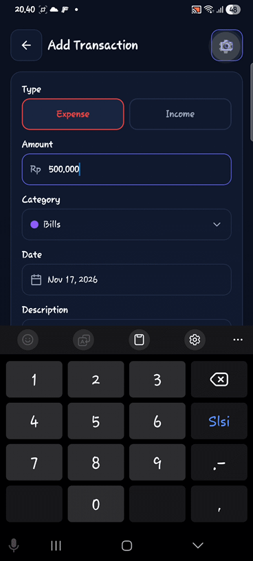
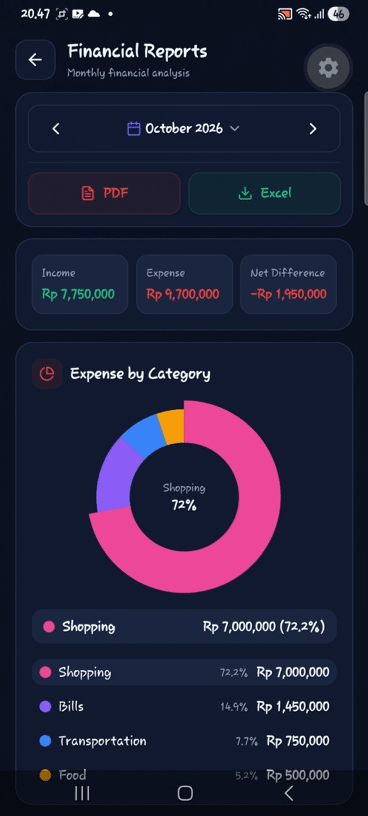
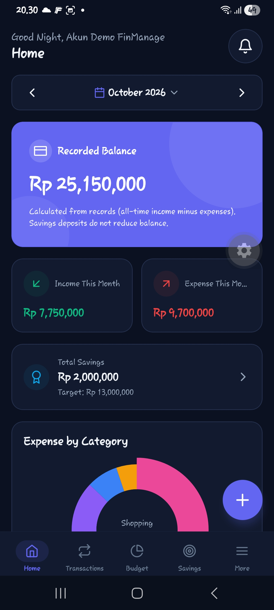
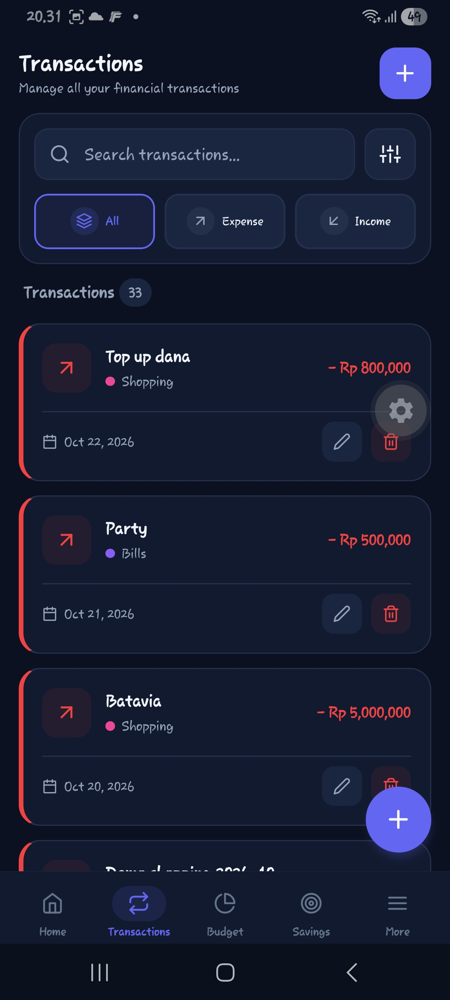
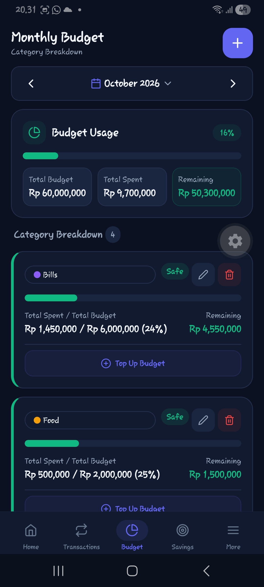
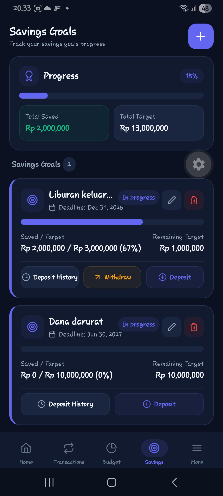
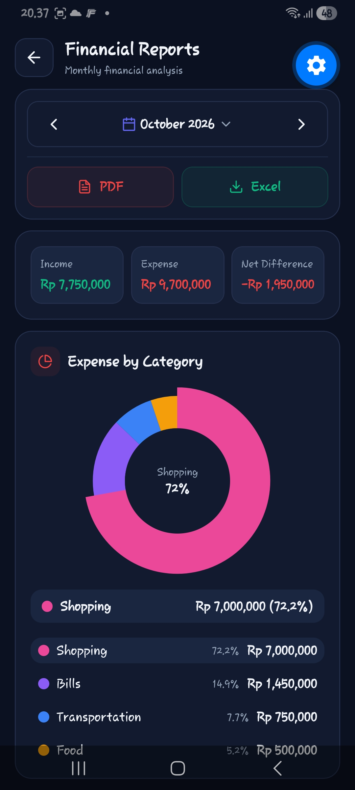
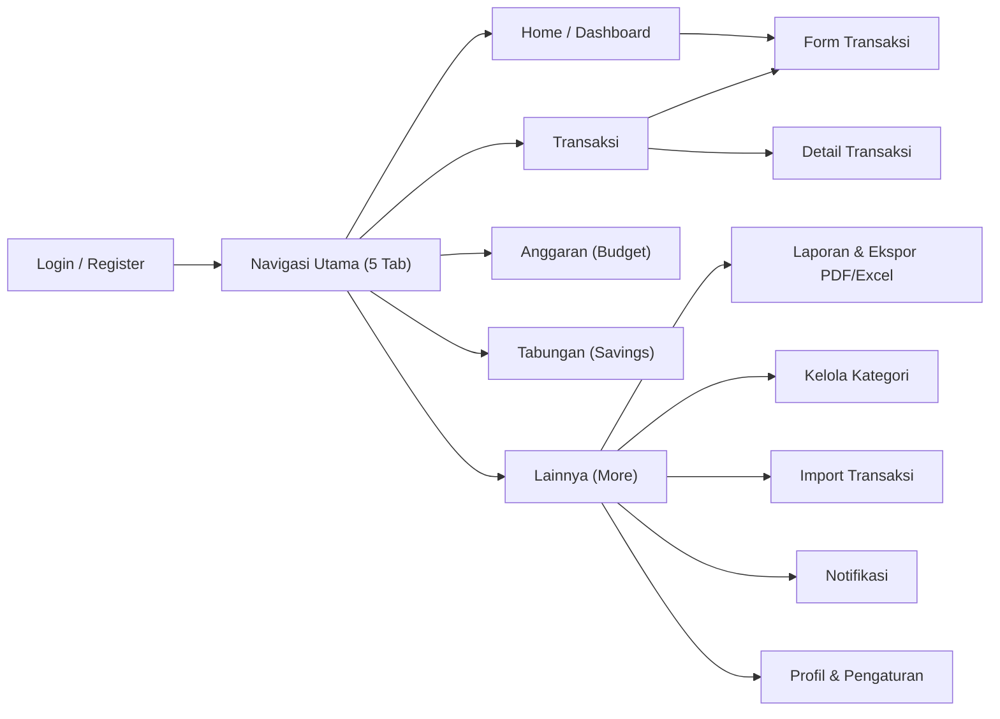

<div align="center">

# FinManage

**Aplikasi Pencatat Keuangan Pribadi untuk Android (React Native + Expo & Express + PostgreSQL)**

FinManage membantu pengguna mencatat pemasukan, pengeluaran, anggaran bulanan, dan target tabungan secara terstruktur. FinManage adalah **aplikasi pencatatan keuangan pribadi** — bukan alat transaksi dan tidak terhubung ke rekening bank mana pun.

-3DDC84?style=flat-square&logo=android&logoColor=white)


</div>

---

## Daftar Isi

- [Fitur Utama](#fitur-utama)
- [Pratinjau Aplikasi](#pratinjau-aplikasi)
  - [Demo Alur Aplikasi](#demo-alur-aplikasi)
  - [Galeri Layar Utama](#galeri-layar-utama)
- [Alur Pengguna (User Flow)](#alur-pengguna-user-flow)
- [Arsitektur & Tech Stack](#arsitektur--tech-stack)
- [Struktur Repositori](#struktur-repositori)
- [Menjalankan Proyek Secara Lokal](#menjalankan-proyek-secara-lokal)
  - [1. Prasyarat](#1-prasyarat)
  - [2. Backend API](#2-backend-api)
  - [3. Aplikasi Mobile (Expo Go)](#3-aplikasi-mobile-expo-go)
- [Skrip Pengujian & Kualitas Kode](#skrip-pengujian--kualitas-kode)
- [Dokumentasi Teknis](#dokumentasi-teknis)
- [Aturan Pengembangan](#aturan-pengembangan)

---

## Fitur Utama

- **Autentikasi & Keamanan Akun**: Registrasi, login, reset password, hashing password dengan Argon2, autentikasi JWT, serta penyimpanan token aman di perangkat (`expo-secure-store`).
- **Dashboard Ringkasan Keuangan**: Menampilkan ringkasan saldo, total pemasukan & pengeluaran bulanan, dan daftar transaksi terbaru.
- **Manajemen Transaksi & Scan Struk**: Pencatatan pemasukan dan pengeluaran lengkap dengan kategori, catatan, filter periode (`MonthYearPicker`), detail *bottom sheet*, serta fitur ekstraksi struk (opsional menggunakan Gemini API jika `SCAN_ENABLED` aktif).
- **Anggaran (Budget) Bulanan**: Pembuatan batas anggaran per kategori lengkap dengan *progress bar* pemakaian dan notifikasi.
- **Target Tabungan (Savings Goals)**: Pelacakan progres tabungan menuju target dana tertentu.
- **Laporan & Analitik**: Visualisasi grafik *Bar*, *Pie*, dan *Trend Line* (`react-native-gifted-charts`), serta ekspor laporan ke format **PDF** (`pdfkit`) dan **Excel** (`exceljs`).
- **Import Transaksi & Kategori Kustom**: Dukungan impor data transaksi dan pengelolaan kategori pemasukan/pengeluaran.
- **Personalisasi**: Dukungan multi-bahasa (**Indonesia & Inggris**), multi-mata uang, tema **Light & Dark Mode**, serta *push notification* (`expo-server-sdk`).

---

## Pratinjau Aplikasi

### Demo Alur Aplikasi

| Catat Transaksi & Pembaruan Dashboard | Laporan Analitik & Ekspor |
| :---: | :---: |
|  |  |
| *Menambah transaksi baru dan pembaruan ringkasan saldo secara langsung.* | *Mengganti periode laporan pada grafik dan mengekspor laporan.* |

### Galeri Layar Utama

| Dashboard | Daftar Transaksi | Anggaran (Budget) |
| :---: | :---: | :---: |
|  |  |  |

| Target Tabungan | Laporan & Grafik |
| :---: | :---: |
|  |  |

---

## Alur Pengguna (User Flow)



### 1. Autentikasi & Onboarding
1. Pengguna membuka aplikasi dan masuk melalui halaman **Login** (`(auth)/login.tsx`) atau mendaftar akun baru di **Register** (`(auth)/register.tsx`).
2. Backend memvalidasi kredensial (Argon2 + JWT) dan mengembalikan token autentikasi.
3. Token disimpan secara aman di perangkat menggunakan `expo-secure-store`, lalu pengguna diarahkan ke **Dashboard**.

### 2. Pencatatan & Detail Transaksi
1. Dari tab **Home** (`(tabs)/index.tsx`) atau **Transaksi** (`(tabs)/transactions.tsx`), pengguna menekan tombol tambah transaksi untuk membuka **Form Transaksi** (`transaction/form.tsx`).
2. Pengguna memilih tipe transaksi (*Pemasukan* / *Pengeluaran*), kategori, nominal, tanggal, dan catatan opsional.
3. Setelah disimpan, ringkasan saldo di Dashboard serta daftar transaksi langsung diperbarui. Pengguna dapat mengetuk item transaksi untuk melihat, mengubah, atau menghapus data melalui *bottom sheet* detail (`TransactionDetailSheet`).

### 3. Pengelolaan Anggaran (Budget) & Target Tabungan (Savings)
- **Anggaran (`(tabs)/budget.tsx`)**: Pengguna menetapkan batas anggaran bulanan per kategori. Setiap transaksi pengeluaran yang tercatat pada kategori terkait otomatis memperbarui *progress bar* pemakaian anggaran.
- **Tabungan (`(tabs)/savings.tsx`)**: Pengguna membuat target dana (*savings goal*) beserta nominal target, lalu mencatat progres setoran hingga target tercapai.

### 4. Analisis Laporan & Ekspor Data
1. Pengguna membuka tab **Lainnya** (`(tabs)/more.tsx`) dan memilih menu **Laporan** (`reports.tsx`).
2. Pengguna memilih periode bulan melalui `MonthYearPicker` untuk melihat visualisasi grafik (*Pie Chart*, *Bar Chart*, dan *Trend Line*).
3. Pengguna dapat mengekspor laporan ke format **PDF** atau **Excel** dan langsung membagikannya melalui `expo-sharing`.

### 5. Kategori, Import & Personalisasi
Melalui tab **Lainnya** (`(tabs)/more.tsx`), pengguna dapat:
- Menambah atau mengubah **Kategori Kustom** (`categories.tsx`).
- Melakukan **Import Transaksi** dari file (`import.tsx`).
- Memeriksa riwayat **Notifikasi** (`notifications.tsx`) dan status koneksi server (*Server Check*).
- Mengubah **Profil** (`profile.tsx`) serta menyesuaikan bahasa (**Indonesia / Inggris**), mata uang, dan tema (**Light / Dark Mode**) di **Pengaturan** (`settings.tsx`).

---

## Arsitektur & Tech Stack

### Mobile (`mobile/`)
- **Framework**: React Native (`0.86`) + Expo (`~57`) + Expo Router
- **Bahasa**: TypeScript
- **State & Data Fetching**: TanStack React Query (`@tanstack/react-query`) + Axios
- **Form & Validasi**: React Hook Form + Zod
- **Visualisasi & UI**: `react-native-gifted-charts`, `@expo/vector-icons`, `react-native-reanimated`, Light/Dark Theme, i18n (`id` & `en`)
- **Keamanan & Native**: `expo-secure-store`, `expo-image-picker`, `expo-document-picker`, `expo-file-system`, `expo-sharing`

### Backend (`backend/`)
- **Runtime & Framework**: Node.js (`>= 20`), Express 5, TypeScript
- **Database & ORM**: PostgreSQL + Prisma ORM (`@prisma/client`)
- **Keamanan & Middleware**: Argon2, JSON Web Token (`jsonwebtoken`), Helmet, CORS, `express-rate-limit`, Pino logger
- **Validasi & Utilitas**: Zod, Multer (upload), PDFKit (ekspor PDF), ExcelJS (ekspor Excel), `expo-server-sdk` (push notification)

---

## Struktur Repositori

| Folder | Isi | Status |
|---|---|---|
| `mobile/` | Aplikasi Android (React Native + Expo + TypeScript) | Aktif dikembangkan |
| `backend/` | REST API (Express + TypeScript + Prisma + PostgreSQL) | Aktif dikembangkan |
| `docs/` | PRD, kontrak API (`contract.md`), aturan bisnis (`rules.md`), model data, spesifikasi layar | Dokumentasi |
| `assets/` | Penyimpanan media README (`screenshots/` dan `gifs/`) | Dokumentasi visual |
| `frontend-finance-web/` | Website lama (React + Vite) | **READ-ONLY — dilarang diubah** |

---

## Menjalankan Proyek Secara Lokal

### 1. Prasyarat
- **Node.js** versi `>= 20`
- **PostgreSQL** (lokal atau *managed database*)
- **Expo Go** di perangkat Android (atau Android Emulator)

### 2. Backend API

```bash
cd backend
copy .env.example .env   # Linux/macOS: cp .env.example .env
```

Lengkapi variabel di `backend/.env` (seperti `DATABASE_URL`, `DIRECT_URL`, `JWT_SECRET`, dan konfigurasi opsional seperti `GEMINI_API_KEY` / `SCAN_ENABLED`). Lalu jalankan:

```bash
npm install
npx prisma migrate dev
npx prisma db seed
npm run dev
```

### 3. Aplikasi Mobile (Expo Go)

```bash
cd mobile
copy .env.example .env   # Linux/macOS: cp .env.example .env
```

Isi `EXPO_PUBLIC_API_URL` pada `mobile/.env` dengan alamat IP lokal mesin backend (misal `http://192.168.1.10:3000/api/v1`), lalu jalankan:

```bash
npm install
npx expo start
```

Pindai QR code yang muncul menggunakan aplikasi **Expo Go** di HP Android (pastikan HP dan komputer berada di jaringan Wi-Fi yang sama).

---

## Skrip Pengujian & Kualitas Kode

**Backend (`cd backend`):**
```bash
npm run typecheck   # Cek tipe TypeScript (tsc --noEmit)
npm run lint        # Cek aturan ESLint
npm test            # Jalankan unit/integration test (Vitest)
npm run build       # Build TypeScript ke dist/
```

**Mobile (`cd mobile`):**
```bash
npm run typecheck   # Cek tipe TypeScript (tsc --noEmit)
npm run lint        # Cek aturan ESLint
npm run check:i18n  # Validasi kelengkapan terjemahan ID & EN
```

---

## Dokumentasi Teknis

Daftar dokumen acuan di dalam folder [`docs/`](docs/):

- [`docs/contract.md`](docs/contract.md) — Konvensi dan kontrak REST API
- [`docs/rules.md`](docs/rules.md) — Aturan bisnis (`BR-xx`) dan kontrol keamanan
- [`docs/data-model.md`](docs/data-model.md) — Skema tabel database dan constraint
- [`docs/screens.md`](docs/screens.md) — Navigasi, kebutuhan layar, dan design token mobile
- [`docs/prompts/`](docs/prompts/) — Panduan prompt per modul

---

## Aturan Pengembangan

- `frontend-finance-web/` berstatus **READ-ONLY**. Jangan mengubah, menghapus, memindahkan, atau memformat file apa pun di dalamnya.
- Jangan melakukan *commit* file `.env`, kunci API, token, atau kredensial apa pun ke repositori.
