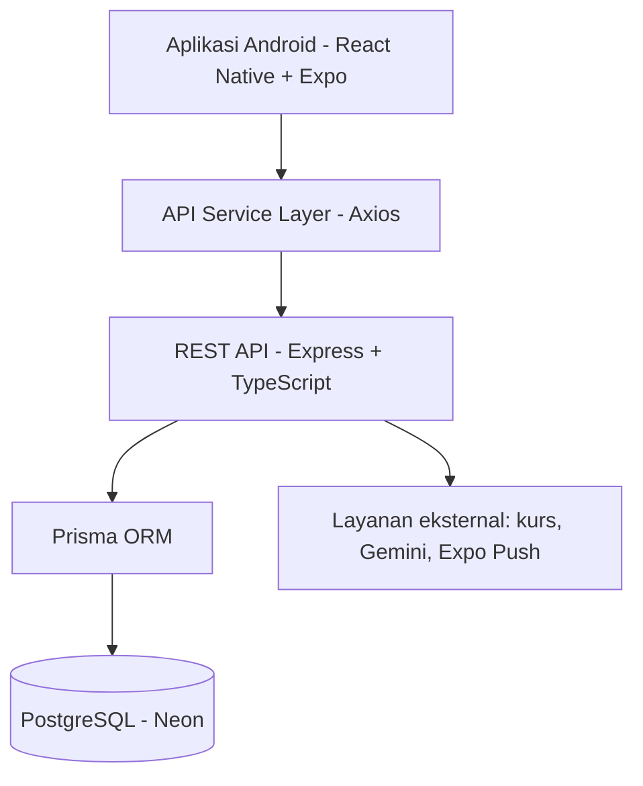
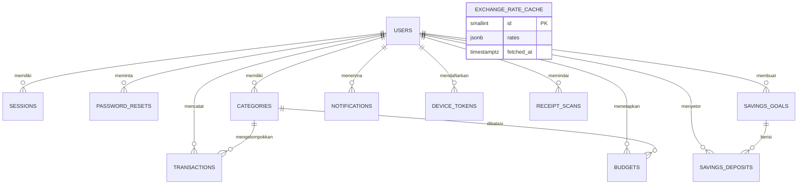

# Product Requirements Document (PRD)

**FinManage Android — Aplikasi Pencatat Keuangan Pribadi** Versi dokumen 1.0 | 16 Oktober 2026 | Status: Draft untuk review

---

## Daftar Isi

- [1. Informasi Dokumen](#m08vagpb8we.157)
- [2. Ringkasan Eksekutif](#m08vagpb8we.1289)
- [3. Latar Belakang dan Perubahan Platform](#m08vagpb8we.2853)
- [4. Tujuan dan Sasaran Produk](#m08vagpb8we.4442)
- [5. Target Pengguna](#m08vagpb8we.6307)
- [6. Ruang Lingkup MVP dan Prioritas](#m08vagpb8we.6747)
- [7. Tech Stack](#m08vagpb8we.7776)
- [8. Arsitektur Sistem](#m08vagpb8we.11709)
- [9. User Flow](#m08vagpb8we.16165)
- [10. Sitemap dan Navigasi Android](#m08vagpb8we.17172)
- [11. Kebutuhan Fungsional](#m08vagpb8we.18085)
- [12. Aturan Bisnis](#m08vagpb8we.27587)
- [13. Kebutuhan Non-Fungsional](#m08vagpb8we.31459)
- [14. UI/UX dan Design System](#m08vagpb8we.32763)
- [15. State Management dan Data Flow](#m08vagpb8we.35298)
- [16. Authentication dan Security](#m08vagpb8we.36482)
- [17. Database Schema dan ERD](#m08vagpb8we.37998)
- [18. REST API Specification](#m08vagpb8we.43530)
- [19. Struktur Folder Project](#m08vagpb8we.52348)
- [20. Roadmap dan Milestone](#m08vagpb8we.54902)
- [21. Testing Strategy](#m08vagpb8we.56781)
- [22. Build APK dan Deployment](#m08vagpb8we.58416)
- [23. Acceptance Criteria V1](#m08vagpb8we.61775)
- [24. Risiko dan Mitigasi](#m08vagpb8we.63384)
- [25. Backlog V2](#m08vagpb8we.65126)
- [26. Perubahan dari PRD Website Sebelumnya](#m08vagpb8we.65851)
- [27. Pertanyaan Terbuka dan Keputusan Teknis](#m08vagpb8we.68158)

---

## 1. Informasi Dokumen

| Item | Detail |
| --- | --- |
| Nama produk | FinManage Android (Personal Finance Management App) |
| Versi produk | Android V1 (MVP) |
| Platform | Android (APK), React Native + Expo + TypeScript |
| Backend | Node.js, Express.js, TypeScript, Prisma, PostgreSQL, JWT |
| Hosting uji coba | SnapDeploy (backend) + Neon (PostgreSQL), paket gratis tanpa kartu; cadangan demo lokal |
| Dokumen terkait | PRD\_FinManage\_V1.md (website, arsip) dan laporan audit frontend Codex |
| Tenggat | Sekitar 1–2 November 2026 (perkiraan, belum final dari dosen) |
| Aturan folder | Folder `frontend-finance-web/` (website lama) hanya dibaca sebagai referensi dan tidak boleh diubah. Seluruh pekerjaan baru ada di `mobile/` dan `backend/` |

**Penanda dalam dokumen:** **\[KONFIRMASI\]** berarti keputusan baru berupa rekomendasi yang perlu disetujui, dan seluruhnya dirangkum di bagian 27. Keputusan K1 sampai K7 dari diskusi sebelumnya sudah disetujui dan ditulis sebagai ketentuan final. **Ref. Web** pada tabel kebutuhan menunjukkan apakah fitur sudah ada di website (Ada / Sebagian / Tidak ada). Itu bukan klaim bahwa fitur Android sudah dikerjakan: **tidak ada fitur Android yang sudah diimplementasikan saat dokumen ini ditulis.**

---

## 2. Ringkasan Eksekutif

FinManage Android adalah aplikasi untuk **mencatat** keuangan pribadi: pemasukan, pengeluaran, kategori, anggaran bulanan, target tabungan, serta laporan dan grafik. Aplikasi ini **bukan alat transaksi**. Tidak ada uang sungguhan yang disimpan atau dipindahkan, dan aplikasi tidak terhubung ke bank atau e-wallet. Semua angka berasal dari catatan yang diinput pengguna.

Aplikasi dibangun ulang sebagai project baru (React Native + Expo) yang mengakses REST API (Express + Prisma) dengan database PostgreSQL di luar perangkat. Website FinManage yang sudah sekitar 50% jadi dipertahankan utuh sebagai referensi fitur, desain, dan aturan bisnis.

Beberapa hal yang membedakan V1 Android dari rencana website:

1. **Backend dan database nyata**: autentikasi dengan JWT, password di-hash, data terpisah per pengguna, dan server menjadi sumber data tunggal.
2. **Lima peningkatan fitur**: export PDF/Excel yang benar-benar berfungsi, import data dari Excel, mata uang tambahan, notifikasi push, dan scan nota otomatis untuk mengisi form transaksi. Sinkronisasi cloud dipenuhi oleh arsitektur server-sebagai-sumber-data (lihat 8.8).
3. **Aturan bisnis diperketat** berdasarkan audit (kategori, budget, tabungan, validasi).
4. **Dua jalur demo**: hosting gratis tanpa kartu (SnapDeploy + Neon) sebagai jalur utama, dan demo lokal melalui HP sebagai cadangan.

**Catatan kejujuran jadwal:** ruang lingkup ini besar untuk waktu sekitar dua minggu (tenggat sekitar 1–2 November). Karena itu fitur dibagi tiga tingkat prioritas (bagian 6). Jika waktu mepet, fitur P2 dipotong lebih dulu agar inti aplikasi tetap rapi dan bisa didemokan.

---

## 3. Latar Belakang dan Perubahan Platform

### 3.1 Kondisi sebelum perubahan

- Website (React + Vite + Tailwind) sekitar 50% selesai; data di LocalStorage, login berupa akun demo, belum ada backend, database, atau integrasi API.
- Audit Codex menunjukkan kesesuaian kebutuhan fungsional website sekitar **80% (57 dari 71 kebutuhan sesuai; 8 sebagian; 6 belum)** setelah dihitung ulang dari tabel laporan (ringkasan laporan menyebut 84,5%, ada selisih hitung pada modul Transactions, Budget, dan Settings). Angka ini mengukur kesesuaian fitur frontend, **bukan progres project**: integrasi API, autentikasi nyata, testing, dan deployment masih nol.

### 3.2 Keputusan perubahan

Arah lama: Website React → Backend → Deploy web. Arah baru: **Android React Native + Expo → Backend REST API → PostgreSQL → APK**. Website dihentikan sementara, tidak dihapus, dan tidak dimodifikasi.

### 3.3 Aset website yang dipakai ulang

| Aset website | Pemakaian di Android |
| --- | --- |
| Daftar fitur, user story, aturan bisnis | Dasar PRD ini, dengan perbaikan dari audit |
| `id.json` dan `en.json` | Kunci terjemahan dipakai ulang dan ditambah kunci baru |
| Kategori bawaan (`initialData.js`) | Menjadi seed kategori default per pengguna |
| Logika kurs (cache 1 jam, fallback) | Dipindah ke backend |
| Skema Zod (`validations.js`) | Titik awal skema validasi, dengan perbaikan (misalnya `budgetAmount` harus lebih dari 0) |
| Komponen web, Tailwind/TailGrids, Recharts, GSAP, React Router DOM, react-hot-toast | **Tidak dipakai.** Diimplementasi ulang dengan komponen React Native |
| Backup/Restore dan Reset Data (LocalStorage) | **Dihapus**, karena server adalah sumber data |

---

## 4. Tujuan dan Sasaran Produk

### 4.1 Tujuan produk

Aplikasi harus mampu:

- Mencatat pemasukan dan pengeluaran.
- Menghitung saldo catatan secara otomatis.
- Mengelompokkan transaksi berdasarkan kategori.
- Membuat budget bulanan dan memantau progresnya.
- Membuat target tabungan dan memantau progresnya.
- Menampilkan laporan dan statistik keuangan.

Peningkatan fitur V1:

- Export laporan ke PDF dan Excel yang benar-benar berfungsi.
- Import transaksi dari Excel untuk pengguna yang sudah punya catatan keuangan di Excel.
- Mata uang tampilan selain IDR, USD, EUR.
- Notifikasi push dan sinkronisasi cloud antar perangkat.
- Scan nota atau bukti transaksi untuk mengisi form transaksi secara otomatis.

### 4.2 Sasaran proyek

- Memenuhi tugas kuliah: aplikasi Android untuk User yang mengakses API backend.
- Menjadi bahan belajar full-stack mobile dan portfolio.

### 4.3 Di luar cakupan V1 (Non-Goals)

Sesuai keputusan Anda, item berikut dari daftar V2 website **tidak dikerjakan**:

- Wallet (Bank, Cash, E-Wallet) dan transfer antar wallet.
- Transaksi berulang (recurring) dan pengingat tagihan (bills reminder).
- Dashboard analitik mendalam.

Tidak dikerjakan juga: peran Admin dan manajemen pengguna, mode offline penuh, penyimpanan foto nota, pembayaran atau koneksi ke bank, aplikasi iOS, dan versi web.

### 4.4 Metrik keberhasilan (usulan)

| Metrik | Usulan target |
| --- | --- |
| Alur inti (register, login, CRUD, budget, tabungan, laporan) berjalan lewat API di HP fisik | 100% lolos uji manual |
| Mencatat satu transaksi manual | 3 langkah atau kurang, di bawah 30 detik |
| Konsistensi angka (saldo, budget, laporan) terhadap transaksi | 0 selisih pada skenario uji |
| Respons API data biasa saat server aktif | di bawah 500 ms untuk 95% request |
| Isolasi data antar pengguna | 100% lolos uji otomatis |
| APK dapat dipasang dan dipakai di HP lain | Berhasil di minimal 2 perangkat |

---

## 5. Target Pengguna

| Segmen | Kebutuhan utama |
| --- | --- |
| Mahasiswa | Mengatur uang saku, menahan pengeluaran, menabung untuk target kecil |
| Karyawan | Memantau gaji vs pengeluaran, menjaga budget bulanan |
| Freelancer | Mencatat pemasukan tidak tetap dari beberapa sumber |
| Pengguna dengan catatan Excel | Pindah ke aplikasi tanpa mengetik ulang (fitur import) |

Peran sistem hanya satu: **User**. Setiap pengguna hanya dapat mengakses data miliknya sendiri.

---

## 6. Ruang Lingkup MVP dan Prioritas

Semua fitur di bawah termasuk V1. Prioritas menentukan **urutan pengerjaan** dan **urutan pemotongan** bila waktu tidak cukup. **\[KONFIRMASI\]**

| Prioritas | Modul | Catatan |
| --- | --- | --- |
| **P0** (inti, wajib untuk demo) | Authentication (register, login, logout, sesi), Categories, Transactions, Dashboard, Budget (termasuk aturan budget tidak memblokir transaksi), Savings Goals, Reports (tampilan), Settings dasar (tema, bahasa, mata uang IDR/USD/EUR), deploy backend, build APK | Tanpa ini aplikasi tidak bisa didemokan |
| **P1** (peningkatan, dikerjakan setelah P0) | Export PDF/Excel, Import Excel, mata uang tambahan, Profile, ubah password dan keluar dari semua perangkat, notifikasi in-app, Transaction Detail, tambah budget cepat | Dikerjakan berurutan setelah P0 stabil |
| **P2** (dikerjakan terakhir, dipotong lebih dulu) | Scan nota, notifikasi push, Financial Insight sederhana, lupa password via OTP email, tarik tabungan dan tambah budget dari tabungan | Paling banyak dependensi eksternal (Gemini, FCM, layanan email) |

Sinkronisasi cloud tidak punya pekerjaan terpisah: ia otomatis ada karena data disimpan di server (lihat 8.8).

Aturan pemotongan: bila tenggat dekat, P2 dipotong lebih dulu dengan urutan: tarik tabungan dan budget dari tabungan, lupa password, Financial Insight, push notification, lalu scan nota. P1 baru dipotong sesudahnya. P0 tidak dipotong.

---

## 7. Tech Stack

### 7.1 Android (folder `mobile/`)

| Kebutuhan | Teknologi | Status |
| --- | --- | --- |
| Framework dan platform | React Native + Expo (SDK stabil terbaru yang didukung aplikasi Expo Go di Play Store saat setup) | Diputuskan |
| Bahasa | TypeScript (strict) | Diputuskan |
| Navigasi | Expo Router | Diputuskan |
| HTTP client | Axios | Diputuskan |
| Data server (cache, loading, error) | TanStack Query | Rekomendasi disetujui |
| Form dan validasi | React Hook Form + Zod | Rekomendasi disetujui |
| Styling | `StyleSheet` + file theme (token warna terang/gelap), tanpa NativeWind | Rekomendasi disetujui |
| Grafik | `react-native-gifted-charts` + `react-native-svg` | Rekomendasi disetujui |
| Ikon | `@expo/vector-icons` (set Feather, paling mirip Lucide di web) | Rekomendasi disetujui |
| Token | `expo-secure-store` | Rekomendasi disetujui |
| Preferensi dan kurs terakhir | `@react-native-async-storage/async-storage` | Rekomendasi disetujui |
| Tanggal | `@react-native-community/datetimepicker` | Rekomendasi disetujui |
| Foto nota dan avatar | `expo-image-picker`, `expo-image-manipulator` | Baru **\[KONFIRMASI\]** |
| File Excel dan PDF | `expo-document-picker`, `expo-file-system`, `expo-sharing` | Baru **\[KONFIRMASI\]** |
| Notifikasi push | `expo-notifications`, `expo-device`, `expo-constants` | Baru **\[KONFIRMASI\]** |
| Izin HTTP untuk demo lokal | `expo-build-properties` (hanya profil build lokal) | Baru **\[KONFIRMASI\]** |
| Bottom sheet | `Modal` bawaan React Native | Rekomendasi (tanpa dependency tambahan) |
| Terjemahan | Hook `useTranslation` buatan sendiri memakai `id.json` dan `en.json` | Rekomendasi disetujui |
| Animasi | `Animated` bawaan RN, seperlunya | Rekomendasi disetujui |

Tailwind web, TailGrids, Recharts, GSAP, dan React Router DOM **tidak dipakai**.

### 7.2 Backend (folder `backend/`)

| Kebutuhan | Teknologi |
| --- | --- |
| Runtime dan framework | Node.js + Express.js + TypeScript |
| ORM dan database | Prisma + PostgreSQL |
| Validasi | Zod |
| Autentikasi | JWT (`jsonwebtoken`), hash password Argon2id (cadangan: bcrypt bila Argon2 gagal terpasang di hosting) |
| Keamanan HTTP | `helmet`, `cors`, `express-rate-limit` |
| Upload file | `multer` (memory storage, batas ukuran) |
| Excel (baca dan tulis) | `exceljs` |
| PDF | `pdfkit` (ringan, cocok untuk memori 512 MB di paket gratis) |
| Push | `expo-server-sdk` |
| Ekstraksi nota | Google Gemini API lewat lapisan abstraksi `ReceiptExtractor` **\[KONFIRMASI\]** |
| Logging | `pino` (tanpa data pribadi dan tanpa token) |
| Pengujian | Vitest + Supertest |

### 7.3 Layanan eksternal dan hosting (diverifikasi Oktober 2026)

| Layanan | Fungsi | Paket gratis dan batasannya |
| --- | --- | --- |
| Neon | PostgreSQL | Permanen tanpa kartu kredit: 0,5 GB per project, 100 CU-jam per bulan, compute tidur setelah 5 menit idle, riwayat pemulihan sekitar 6 jam |
| SnapDeploy (hosting utama, diuji di M0) | Hosting backend dari repositori GitHub (Dockerfile) | Tanpa kartu: 100 jam berjalan per bulan, 512 MB RAM dan 0,25 vCPU per container, tidur setelah 15 menit idle dan bangun sekitar 60 detik, mendukung database eksternal seperti Neon. Sumber utamanya blog vendor sendiri, jadi verifikasi di dokumentasi SnapDeploy |
| Render (opsional) | Hosting backend | 750 jam per bulan, 512 MB RAM, tidur setelah 15 menit. Menurut pengalaman Anda akun baru kini diminta verifikasi kartu, jadi bukan jalur utama |
| Demo lokal + tunnel (cadangan) | Laptop sebagai server; URL HTTPS publik lewat ngrok atau Cloudflare Tunnel | Gratis; laptop harus menyala dan online; ketentuan tunnel dicek saat dipakai |
| Firebase (FCM) | Pengiriman push ke Android | Gratis; butuh project Firebase dan kredensial yang diunggah ke EAS |
| Expo Push Service | Relay push | Gratis |
| Google Gemini API | Ekstraksi data nota | Paket gratis dengan batas request; data pada paket gratis dapat dipakai Google untuk meningkatkan produknya (lihat 16.10) |
| open.er-api.com | Kurs mata uang | Gratis tanpa API key |
| EAS Build | Build APK di cloud | Gratis: sekitar 15 build Android per bulan, antrean prioritas rendah (bisa menunggu satu jam atau lebih), batas 45 menit per build |

**Mengapa bukan platform lain.** Render tetap platform termudah, tetapi Anda melaporkan akun baru kini diminta verifikasi kartu (sumber publik yang saya temukan masih menyebut tanpa kartu, jadi kemungkinan ini pemeriksaan per akun atau wilayah). Fly.io tidak lagi punya paket gratis untuk akun baru dan meminta kartu. Koyeb meminta kartu sejak Februari 2026. Oracle Cloud Always Free meminta kartu, kini hanya 2 OCPU dan 12 GB RAM, kapasitas sering habis, instance yang idle dapat diambil kembali, dan server dikelola sendiri. Batas gratis berubah sewaktu-waktu, jadi **verifikasi ulang di halaman resmi tiap layanan sebelum deploy.**

### 7.4 Penyimpanan lokal di Android

| Data | Tempat | Alasan |
| --- | --- | --- |
| Token JWT | `expo-secure-store` | Terenkripsi oleh Android Keystore |
| Tema, bahasa, mata uang tampilan | AsyncStorage | Non-sensitif |
| Kurs terakhir (untuk cadangan) | AsyncStorage | Non-sensitif |
| Data keuangan (transaksi dll.) | **Hanya memori** (cache TanStack Query, tidak disimpan ke disk) | Mencegah data finansial tersimpan tidak terenkripsi |

---

## 8. Arsitektur Sistem



### 8.1 Tanggung jawab tiap lapisan

| Lapisan | Tanggung jawab |
| --- | --- |
| UI (layar dan komponen) | Tampilan, input, navigasi. Tidak memanggil Axios langsung |
| API service layer | Satu instance Axios, penempelan token, normalisasi error, fungsi per resource |
| Hook data (TanStack Query) | Loading, error, cache, refetch, invalidasi setelah mutasi |
| REST API | Autentikasi, otorisasi, validasi, aturan bisnis, perhitungan saldo/budget/laporan |
| Prisma dan PostgreSQL | Penyimpanan, relasi, constraint, transaksi database |

### 8.2 Alur autentikasi

Register: server membuat user, men-hash password (Argon2id), menyalin kategori bawaan ke akun baru, dan membuat sesi dalam satu transaksi database, lalu mengembalikan token JWT (berlaku 7 hari, memuat id sesi) dan data user. Login: validasi email dan password, buat sesi baru, kembalikan token. Pada setiap request server memverifikasi token dan memastikan sesinya masih aktif (16.2). Saat aplikasi dibuka: baca token dari SecureStore, panggil `GET /profile`; jika sukses masuk ke tab utama, jika 401 hapus token dan tampilkan Login. Logout: aplikasi mencabut push token, server mencabut sesi, lalu token lokal dan cache dihapus.

### 8.3 Alur CRUD transaksi

Form (React Hook Form + Zod) → `POST /transactions` → server memvalidasi (Zod), memeriksa kategori milik user dan tipe cocok, menyimpan, lalu mengevaluasi ambang budget dan membuat notifikasi bila perlu → respons 201 → aplikasi menginvalidasi cache `transactions`, `dashboard`, `budgets`, `reports`, `notifications` → toast sukses.

### 8.4 Penanganan error dan loading

- Semua error API berformat `{ error: { code, message, details } }`; lapisan Axios menerjemahkannya menjadi pesan terbaca dalam bahasa aktif.
- Loading awal memakai skeleton atau indikator sederhana; aksi mutasi menonaktifkan tombol dan menampilkan spinner.
- Empty state dan error state (dengan tombol Coba lagi) wajib ada di setiap daftar.
- Error 401: logout otomatis. Error jaringan atau timeout: pesan khusus dan tombol coba lagi.

### 8.5 Perhitungan di server

Saldo catatan, total bulanan, progres budget, total tabungan, agregasi laporan, dan insight **selalu dihitung server dari data transaksi pada setiap request**. Hasil turunan tidak disimpan di database (menghindari nilai basi seperti `spentAmount` di website).

### 8.6 Kurs mata uang

Backend mengambil kurs dari `open.er-api.com`, menyimpannya di tabel cache dengan TTL 1 jam (diperbarui secara lazy saat ada request, karena hosting gratis tidur dan tidak andal untuk cron). Jika API gagal: pakai cache terakhir, lalu nilai cadangan di kode. Aplikasi mengambil kurs lewat `GET /currencies`, menyimpannya di AsyncStorage sebagai cadangan, dan menampilkan waktu pembaruan terakhir.

### 8.7 Koneksi internet dan perilaku saat gagal

V1 **membutuhkan internet untuk semua fitur data** (login, transaksi, laporan, dan seterusnya). Offline penuh tidak dijanjikan. Saat koneksi atau server gagal, aplikasi menampilkan error state dengan tombol coba lagi dan tetap menampilkan data yang sudah ada di memori pada sesi itu. Tema, bahasa, dan mata uang tetap bisa diganti tanpa internet.

Khusus hosting gratis: request pertama setelah server tidur bisa memakan sekitar satu menit. Aplikasi memanggil `GET /health` saat dibuka, menampilkan pesan Menyiapkan server…, dan memakai timeout lebih panjang (60 detik) untuk request pertama.

### 8.8 Sinkronisasi cloud **\[KONFIRMASI\]**

Sinkronisasi cloud dipenuhi dengan arsitektur ini: data tersimpan di server PostgreSQL, sehingga login di HP lain menampilkan data yang sama. Tidak ada mekanisme sinkronisasi offline-first (antrean perubahan lokal, resolusi konflik). Bila yang Anda maksud adalah bekerja offline lalu sinkron otomatis, itu fitur besar yang disarankan masuk V2.

### 8.9 Alur push, scan, export, import (ringkas)

- **Push:** setelah login, aplikasi meminta izin dan mendaftarkan Expo push token ke `POST /devices`. Saat transaksi atau deposit memicu peristiwa penting, server membuat notifikasi dan mengirim push lewat Expo Push Service ke FCM.
- **Scan nota:** foto dikompres di HP, diunggah ke `POST /receipts/scan`, server meminta Gemini mengekstrak data, lalu hasilnya mengisi form transaksi untuk direview pengguna.
- **Export:** server membuat file PDF atau XLSX dari data laporan, aplikasi mengunduhnya dan membukanya lewat share sheet Android.
- **Import:** aplikasi mengunggah file XLSX, server mengembalikan preview terverifikasi, pengguna mengonfirmasi, lalu server menyimpan.

---

## 9. User Flow

**Alur inti harian:** Buka aplikasi → (login bila perlu) → Beranda → tombol + → isi transaksi → Simpan → Beranda dan Laporan ter-update.

**Alur scan nota:** Tombol + → Scan nota → kamera atau galeri → Menganalisis… → form terisi (jumlah, tanggal, deskripsi, saran kategori) → pengguna memeriksa dan mengoreksi → Simpan. Bila gagal: pesan jelas dan tombol Isi manual.

**Alur import Excel:** Lainnya → Import data → aplikasi menampilkan aturan import (kolom yang diizinkan, format, batas, contoh benar dan salah) → unduh template atau pilih file .xlsx → server memeriksa **nama kolom lebih dulu**; bila ada kolom yang tidak dikenal atau kolom wajib yang hilang, import dihentikan dan aplikasi menyebut kolom yang harus dihapus atau ditambah → pengguna memperbaiki file Excel lalu memilih ulang → bila kolom sudah sesuai: preview per baris (valid, bermasalah beserta alasan, kemungkinan duplikat) → pilih opsi kategori tidak dikenal → Konfirmasi → ringkasan hasil.

**Alur budget:** Anggaran → pilih bulan → Tambah budget (kategori pengeluaran + nominal) → catat pengeluaran → progres berubah warna → notifikasi saat mencapai 90% dan saat terlampaui. **Bila budget sudah terlampaui, transaksi tetap bisa dicatat**; sisa budget menjadi negatif dan berwarna merah. Pengguna dapat menekan Tambah budget untuk menaikkan nominalnya, atau (P2) mengalihkan dana dari target tabungan: pilih target dan nominal, lalu tabungan berkurang dan budget bertambah sebesar nominal itu.

**Alur tabungan:** Tabungan → buat target → Setor → progres naik → status Hampir selesai (80–99%) → Selesai (100%) dan notifikasi.

**Alur export:** Laporan → pilih bulan dan tahun → Export → pilih PDF atau Excel → file dibuat → share sheet Android.

**Alur lupa password (P2):** Login → Lupa password → masukkan email → kode 6 digit dikirim ke email (berlaku 10 menit) → masukkan kode dan password baru → semua perangkat keluar → Login ulang.

---

## 10. Sitemap dan Navigasi Android

```
Auth (belum login)
  Login
  Register

Tab utama (sudah login)
  Beranda          -> Detail ringkasan, Notifikasi
  Transaksi        -> Form transaksi (manual / scan nota), Detail transaksi
  Anggaran         -> Form budget
  Tabungan         -> Form target, Setor, Detail target
  Lainnya          -> Kategori, Laporan, Import data, Notifikasi, Profil, Pengaturan
```

- Bottom navigation dengan 5 tab. Tombol aksi + (floating) tersedia di Beranda dan Transaksi dengan pilihan Tambah manual atau Scan nota.
- Form dan detail dibuka sebagai layar penuh atau bottom sheet; tombol back Android menutup sheet atau layar teratas sebelum keluar dari aplikasi.
- Ikon lonceng di header Beranda menampilkan badge notifikasi belum dibaca.
- Mengetuk push notifikasi membuka layar yang relevan (Anggaran, Tabungan, atau daftar Notifikasi).
- Penggunaan layar Lainnya menggantikan sidebar website.

---

## 11. Kebutuhan Fungsional

Semua kebutuhan di bawah **belum diimplementasikan di Android** dan harus dibangun. Kolom **Ref. Web** hanya menunjukkan kondisi website (berdasarkan PRD web dan audit Codex). Prioritas P0/P1/P2 mengacu pada bagian 6.

### 11.1 Authentication (AUTH)

| ID | Kebutuhan | Prio | Ref. Web |
| --- | --- | --- | --- |
| AUTH-01 | Register dengan nama, email, dan password; kategori bawaan disalin ke akun baru | P0 | Tidak ada |
| AUTH-02 | Login dengan email dan password; token JWT disimpan di SecureStore | P0 | Sebagian (akun demo) |
| AUTH-03 | Logout dengan dialog konfirmasi: sesi dicabut di server, token dan cache dihapus dari HP | P0 | Sebagian |
| AUTH-04 | Sesi bertahan setelah aplikasi ditutup; 401 dari server memicu logout otomatis | P0 | Tidak ada |
| AUTH-05 | Ubah password: password lama wajib, sesi di perangkat lain dicabut, perangkat ini menerima token baru | P1 | Tidak ada |
| AUTH-06 | Keluar dari semua perangkat (untuk HP hilang atau akun yang dicurigai) | P1 | Tidak ada |
| AUTH-07 | Validasi: email valid, password 8–128 karakter berisi huruf dan angka | P0 | Sebagian |
| AUTH-08 | Lupa password lewat kode OTP yang dikirim ke email; semua sesi dicabut setelah berhasil **\[KONFIRMASI D16\]** | P2 | Tidak ada |

**Catatan kolom Ref. Web:** kolom itu hanya menunjukkan apakah fitur sudah ada di website. Tertulis Tidak ada bukan berarti tidak akan ada di Android: semua baris pada tabel ini dibangun di Android sesuai prioritasnya. **Ubah password** (AUTH-05) dipakai pengguna yang sudah login dan masih ingat password lama. **Lupa password** (tidak bisa login sama sekali) adalah AUTH-08 dan berprioritas P2; bila tidak sempat dikerjakan, pengguna V1 yang lupa password tidak dapat memulihkan akunnya sendiri dan harus dibantu developer lewat skrip reset. Tidak dikerjakan: Remember Me (aplikasi mobile memang tetap login) dan login sosial.

### 11.2 Dashboard (DASH)

| ID | Kebutuhan | Prio | Ref. Web |
| --- | --- | --- | --- |
| DASH-01 | Salam dan nama bulan dinamis sesuai bahasa | P0 | Ada |
| DASH-02 | Kartu ringkasan: Saldo Catatan, Pemasukan bulan ini, Pengeluaran bulan ini, Total Tabungan; ketuk kartu membuka rincian | P0 | Ada |
| DASH-03 | Pie chart pengeluaran per kategori pada bulan terpilih | P0 | Ada |
| DASH-04 | Line chart tren 6 bulan (pemasukan vs pengeluaran) | P0 | Ada |
| DASH-05 | Lima transaksi terbaru | P0 | Ada |
| DASH-06 | Pemilih bulan dan tahun | P0 | Sebagian |
| DASH-07 | Seluruh nilai tampil sesuai mata uang terpilih | P0 | Ada |
| DASH-08 | Pull-to-refresh | P0 | Tidak ada |
| DASH-09 | Ikon lonceng dengan badge notifikasi belum dibaca | P1 | Ada (web) |
| DASH-10 | Financial Insight sederhana (aturan di BR-23) | P2 | Tidak ada |

**Tampilan dashboard dan grafik.** Beranda disusun dari atas ke bawah: salam dan lonceng notifikasi, empat kartu ringkasan, pie chart pengeluaran per kategori (DASH-03), line chart tren 6 bulan (DASH-04), lima transaksi terbaru, lalu insight (P2). Grafik adalah alat bantu, bukan kewajiban: **grafik hanya ditampilkan bila datanya cukup** (misalnya line chart butuh minimal dua bulan yang berisi data). Bila data kosong atau terlalu sedikit, aplikasi menampilkan empty state singkat, angka, atau daftar peringkat kategori. Jenis grafik boleh disesuaikan dengan layar kecil (misalnya daftar batang horizontal menggantikan pie bila kategori lebih dari 6) tanpa mengubah angka yang ditampilkan.

### 11.3 Transactions (TRX)

| ID | Kebutuhan | Prio | Ref. Web |
| --- | --- | --- | --- |
| TRX-01 | Tambah transaksi: tanggal, tipe, kategori, nominal, deskripsi (opsional) | P0 | Ada |
| TRX-02 | Edit dan hapus transaksi; hapus dengan konfirmasi | P0 | Ada |
| TRX-03 | Pencarian berdasarkan deskripsi dan nama kategori | P0 | Ada |
| TRX-04 | Filter tipe, kategori, dan rentang tanggal | P0 | Sebagian (tanpa rentang tanggal) |
| TRX-05 | Sortir tanggal atau jumlah (naik/turun) | P0 | Ada |
| TRX-06 | Daftar berbentuk kartu dengan infinite scroll, 20 item per halaman | P0 | Beda (web: tabel + pagination) |
| TRX-07 | Ringkasan transaksi sebelum simpan | P1 | Ada |
| TRX-08 | Detail transaksi (bottom sheet) dengan aksi edit dan hapus | P1 | Tidak ada |
| TRX-09 | Validasi form dengan React Hook Form + Zod dan diulang di server | P0 | Menyimpang (web: manual) |

### 11.4 Categories (CAT)

| ID | Kebutuhan | Prio | Ref. Web |
| --- | --- | --- | --- |
| CAT-01 | Kategori bawaan per pengguna. Pemasukan: Salary, Freelance, Bonus, Investment, Other. Pengeluaran: Food, Transportation, Shopping, Bills, Entertainment, Education, Health, Other | P0 | Ada |
| CAT-02 | Tambah, edit, hapus kategori | P0 | Ada |
| CAT-03 | Pilihan warna dari 12 preset (color picker bebas ditunda) | P1 | Sebagian |
| CAT-04 | Nama unik per pengguna dan tipe (tidak peka huruf besar-kecil dan spasi tepi) | P0 | Belum |
| CAT-05 | Kategori yang dipakai transaksi atau budget tidak dapat dihapus; server membalas 409 beserta jumlah pemakaiannya | P0 | Belum |
| CAT-06 | Tipe kategori tidak dapat diubah setelah dipakai | P0 | Menyimpang (web membolehkan) |
| CAT-07 | Preview kategori sebelum simpan | P2 | Ada |

### 11.5 Budget (BUD)

| ID | Kebutuhan | Prio | Ref. Web |
| --- | --- | --- | --- |
| BUD-01 | Tambah budget per kategori pengeluaran untuk bulan dan tahun tertentu | P0 | Sebagian |
| BUD-02 | Edit dan hapus budget | P0 | Sebagian |
| BUD-03 | Ringkasan: Total Budget, Total Terpakai, Sisa | P0 | Ada |
| BUD-04 | Progress bar per kategori dengan status warna (BR-11) | P0 | Ada |
| BUD-05 | Nilai terpakai dihitung server dari transaksi, tidak disimpan | P0 | Menyimpang (web menyimpan `spentAmount`) |
| BUD-06 | Banner peringatan dan notifikasi saat mencapai 90% dan saat terlampaui | P0 | Ada (90%) |
| BUD-07 | Pemilih bulan dan tahun | P0 | Sebagian |
| BUD-08 | Pengeluaran tetap bisa dicatat saat budget sudah terlampaui; sisa budget tampil negatif berwarna merah dengan status Terlampaui (BR-24) | P0 | Tidak jelas |
| BUD-09 | Tombol Tambah budget pada kartu budget untuk menaikkan nominal budget kategori itu dengan cepat | P1 | Tidak ada |
| BUD-10 | Tambah budget dari tabungan: pilih target dan nominal; tabungan target berkurang dan budget bertambah sebesar nominal itu secara atomik (BR-25) | P2 | Tidak ada |

### 11.6 Savings Goals (SAV)

| ID | Kebutuhan | Prio | Ref. Web |
| --- | --- | --- | --- |
| SAV-01 | Tambah, ubah, hapus target (judul, nominal target, deadline opsional) | P0 | Ada |
| SAV-02 | Setor ke target; setoran tercatat sebagai riwayat | P0 | Sebagian (web hanya menambah angka) |
| SAV-03 | Hapus setoran yang keliru | P1 | Tidak ada |
| SAV-04 | Progress per target dan total progress | P0 | Ada |
| SAV-05 | Status: Sedang berjalan, Hampir selesai (80–99%), Selesai (100%) dan badge Selesai | P0 | Ada |
| SAV-06 | Setoran yang melebihi sisa target ditolak dengan pesan sisa yang masih bisa disetor | P0 | Menyimpang (web memotong diam-diam) |
| SAV-07 | Riwayat setoran per target | P1 | Tidak ada |
| SAV-08 | Tarik tabungan dari target: mengurangi jumlah terkumpul, tidak boleh melebihi jumlah terkumpul, hanya mengubah catatan (tidak memengaruhi saldo catatan) | P2 | Tidak ada |

### 11.7 Reports (REP)

| ID | Kebutuhan | Prio | Ref. Web |
| --- | --- | --- | --- |
| REP-01 | Filter bulan dan tahun | P0 | Ada |
| REP-02 | Ringkasan pemasukan, pengeluaran, selisih | P0 | Ada |
| REP-03 | Pie chart pengeluaran per kategori | P0 | Ada |
| REP-04 | Bar chart pemasukan per kategori | P0 | Ada |
| REP-05 | Line chart tren 12 bulan pada tahun terpilih | P0 | Ada |
| REP-06 | Daftar transaksi pada bulan terpilih | P0 | Ada |

### 11.8 Export (EXP)

| ID | Kebutuhan | Prio | Ref. Web |
| --- | --- | --- | --- |
| EXP-01 | Export laporan bulanan ke PDF: judul, nama pengguna, periode, ringkasan, rincian per kategori, daftar transaksi | P1 | Sebagian (print browser) |
| EXP-02 | Export ke Excel (.xlsx) dengan sheet Ringkasan, Per Kategori, dan Transaksi | P1 | Sebagian (CSV) |
| EXP-03 | File dibuat server, diunduh aplikasi, lalu dibuka lewat share sheet Android | P1 | Tidak ada |
| EXP-04 | Nominal di file selalu dalam IDR (mata uang dasar) dan tertulis pada header | P1 | Tidak ada |
| EXP-05 | Batas 5.000 baris transaksi per file; jika lebih, pengguna diminta mempersempit periode | P1 | Tidak ada |

### 11.9 Import Excel (IMP)

| ID | Kebutuhan | Prio | Ref. Web |
| --- | --- | --- | --- |
| IMP-01 | Layar Import data menampilkan **aturan import** sebelum pengguna memilih file: kolom yang diizinkan, format tiap kolom, batas file, serta contoh benar dan salah (bersumber dari `GET /imports/spec`) | P1 | Tidak ada |
| IMP-02 | Template Excel resmi dapat diunduh; susunan kolom mengikuti Excel pengguna: Tanggal, Bulan, Tahun, Tipe, Kategori, Deskripsi, Nominal | P1 | Tidak ada |
| IMP-03 | Nama kolom diperiksa lebih dulu dan harus sama dengan kolom aplikasi (urutan bebas; huruf besar-kecil dan spasi tepi diabaikan). Kolom wajib: Tanggal, Tipe, Kategori, Deskripsi, dan Nominal; tanggal boleh satu kolom Tanggal berisi tanggal lengkap, atau dipecah menjadi Tanggal (angka hari), Bulan, dan Tahun. Kolom No dan Hari boleh ada dan diabaikan **(D17, diperbarui)** | P1 | Tidak ada |
| IMP-04 | Kolom yang tidak dikenal atau kolom wajib yang hilang membuat seluruh file ditolak sebelum baris diproses. Pesan error menyebut kolom yang harus dihapus atau ditambah; pengguna memperbaiki Excel lalu memilih ulang | P1 | Tidak ada |
| IMP-05 | Setelah kolom sesuai: preview per baris (valid, bermasalah beserta alasan per baris, kemungkinan duplikat) dan ringkasan jumlah baris per status | P1 | Tidak ada |
| IMP-06 | Setiap baris wajib memiliki tanggal, Tipe, Kategori, dan Nominal; sel yang kosong atau tidak valid membuat baris itu ditandai bermasalah di preview dan tidak diimpor. Kolom Deskripsi harus ada, tetapi selnya boleh kosong | P1 | Tidak ada |
| IMP-07 | Kategori yang tidak dikenal: pengguna memilih Buat kategori baru (default) atau Masukkan ke Other | P1 | Tidak ada |
| IMP-08 | Baris duplikat (tanggal, tipe, nominal, deskripsi sama dengan data yang sudah ada) ditandai dan dilewati secara default | P1 | Tidak ada |
| IMP-09 | Konfirmasi menyimpan semua baris valid dalam satu transaksi database; ringkasan hasil ditampilkan | P1 | Tidak ada |
| IMP-10 | Batas: .xlsx, maksimal 2 MB dan 1.000 baris, hanya sheet pertama, nama kolom di baris 1 | P1 | Tidak ada |

**Aturan import yang ditampilkan di aplikasi**

1. File berformat .xlsx. Hanya sheet pertama yang dibaca dan baris pertama harus berisi nama kolom.
2. Kolom yang wajib ada: **Tanggal**, **Tipe**, **Kategori**, **Deskripsi**, dan **Nominal**. Urutan kolom bebas. Template resmi memakai susunan Tanggal, Bulan, Tahun, Tipe, Kategori, Deskripsi, Nominal.
3. Kolom **No** dan **Hari** boleh ada dan akan diabaikan. Kolom lain di luar daftar ini (misalnya Jumlah barang atau Total) harus dihapus atau diganti namanya dulu. Aplikasi menolak file dan menyebut kolom mana yang harus diperbaiki.
4. **Tanggal** ditulis dengan salah satu dari dua cara: (a) satu kolom Tanggal berisi tanggal lengkap (YYYY-MM-DD, DD/MM/YYYY, atau sel tanggal Excel); atau (b) tiga kolom seperti di Excel Anda: **Tanggal** berisi angka hari 1–31, **Bulan** berisi angka 1–12 atau nama bulan (Januari, Februari, dan seterusnya), dan **Tahun** berisi 4 digit. Kolom Bulan dan Tahun harus hadir bersama-sama. Tanggal tidak boleh di masa depan atau tidak ada di kalender.
5. **Nominal** adalah total uang dalam rupiah, bilangan bulat lebih dari 0 (boleh berformat Rp atau memakai pemisah ribuan). Jangan mengisinya dengan jumlah barang.
6. **Tipe** diisi Pemasukan atau Pengeluaran (Income atau Expense juga diterima) pada setiap baris.
7. **Kategori** diisi nama kategori pada setiap baris. Jika belum ada di aplikasi, dibuat otomatis atau dimasukkan ke Other sesuai pilihan Anda.
8. **Deskripsi**: kolomnya harus ada, tetapi sel boleh kosong; maksimal 255 karakter.
9. Maksimal 1.000 baris dan 2 MB; sel gabungan (merged) tidak didukung; rumus diperbolehkan (nilai hasilnya yang dibaca).

**Contoh: Excel dengan kolom No, Hari, Tanggal, Bulan, Tahun, Barang Yang Dibeli, Jumlah, Total Rp**

| Kolom di Excel Anda | Yang harus dilakukan |
| --- | --- |
| No | Biarkan (diabaikan) |
| Hari | Biarkan (diabaikan) |
| Tanggal, Bulan, Tahun | Biarkan: dipakai sebagai tanggal (Tanggal berisi angka hari 1–31) |
| Barang Yang Dibeli | Ganti nama kolom menjadi Deskripsi |
| Jumlah (jumlah barang) | Hapus, karena aplikasi tidak menyimpan jumlah barang |
| Total Rp | Ganti nama kolom menjadi Nominal |
| (belum ada) Tipe | Tambahkan kolom Tipe dan isi Pengeluaran atau Pemasukan pada setiap baris |
| (belum ada) Kategori | Tambahkan kolom Kategori dan isi nama kategori pada setiap baris |

Istilah **Nominal** dipakai (bukan Jumlah) agar tidak tertukar dengan jumlah barang yang umum ada di Excel pengguna, dan dipakai di seluruh antarmuka. Pemetaan kolom bebas (pengguna mencocokkan kolomnya sendiri di dalam aplikasi) ditunda ke V2.

### 11.10 Scan Nota (SCN)

| ID | Kebutuhan | Prio | Ref. Web |
| --- | --- | --- | --- |
| SCN-01 | Menu Scan nota pada tombol + dan pada form transaksi | P2 | Tidak ada |
| SCN-02 | Ambil foto dengan kamera atau pilih dari galeri | P2 | Tidak ada |
| SCN-03 | Foto dikompres di HP (sisi terpanjang sekitar 1.280 px, JPEG kualitas sekitar 70%) sebelum diunggah | P2 | Tidak ada |
| SCN-04 | Server mengekstrak: jumlah total, tanggal, nama toko atau penerima (menjadi deskripsi), tipe (default pengeluaran), dan saran kategori dari daftar kategori milik pengguna | P2 | Tidak ada |
| SCN-05 | Hasil mengisi form transaksi; pengguna **wajib memeriksa dan menekan Simpan**. Tidak ada penyimpanan otomatis | P2 | Tidak ada |
| SCN-06 | Jika ekstraksi gagal atau tidak yakin: pesan jelas, field kosong tetap bisa diisi manual | P2 | Tidak ada |
| SCN-07 | Batas 10 scan per pengguna per hari (dapat diubah lewat konfigurasi) untuk menjaga kuota gratis | P2 | Tidak ada |
| SCN-08 | Scan nonaktif sampai pengguna menyetujui (tersimpan di server dan dapat dicabut) bahwa foto dikirim ke layanan AI pihak ketiga | P2 | Tidak ada |
| SCN-09 | Foto nota tidak disimpan di server maupun database | P2 | Tidak ada |

### 11.11 Mata Uang (CUR)

| ID | Kebutuhan | Prio | Ref. Web |
| --- | --- | --- | --- |
| CUR-01 | Mata uang tampilan: IDR, USD, EUR (P0), lalu SGD, MYR, JPY, GBP, AUD, SAR, CNY, KRW, THB (P1) **\[KONFIRMASI\]** | P0/P1 | Sebagian (3 mata uang) |
| CUR-02 | Kurs dari backend (`GET /currencies`), cache 1 jam, fallback bila API gagal | P0 | Sebagian |
| CUR-03 | Tombol refresh kurs dan tampilan waktu pembaruan terakhir | P1 | Ada |
| CUR-04 | Pemilih mata uang di Pengaturan; pilihan tersimpan di perangkat | P0 | Ada |

### 11.12 Notifikasi (NOT)

| ID | Kebutuhan | Prio | Ref. Web |
| --- | --- | --- | --- |
| NOT-01 | Daftar notifikasi in-app dengan ikon per jenis dan waktu relatif | P1 | Ada |
| NOT-02 | Badge jumlah belum dibaca; tandai satu atau semua terbaca | P1 | Ada |
| NOT-03 | Notifikasi dibuat server hanya untuk: budget mencapai 90%, budget terlampaui, target tabungan tercapai | P1 | Beda (web: tiap CRUD) |
| NOT-04 | Push notification untuk tiga peristiwa di atas, dengan izin POST\_NOTIFICATIONS Android 13 ke atas | P2 | Tidak ada |
| NOT-05 | Saklar notifikasi push di Pengaturan (mendaftarkan atau mencabut token perangkat) | P2 | Tidak ada |
| NOT-06 | Mengetuk push membuka layar terkait | P2 | Tidak ada |

Keberhasilan CRUD biasa cukup ditampilkan sebagai toast dan tidak disimpan sebagai notifikasi.

### 11.13 Profile dan Settings (PRO, SET)

| ID | Kebutuhan | Prio | Ref. Web |
| --- | --- | --- | --- |
| PRO-01 | Lihat dan edit nama dan email dengan validasi | P1 | Ada |
| PRO-02 | Avatar: ambil dari galeri, diperkecil sekitar 256 px, disimpan di server sebagai teks (batas sekitar 100 KB) | P1 | Ada (base64 lokal) |
| PRO-03 | Statistik: total transaksi, jumlah target, total tabungan | P1 | Ada |
| SET-01 | Tema: Ikuti sistem, Terang, Gelap | P0 | Ada |
| SET-02 | Bahasa: Indonesia dan English tanpa restart | P0 | Ada |
| SET-03 | Mata uang tampilan (lihat CUR) | P0 | Ada |
| SET-04 | Saklar notifikasi push (lihat NOT-05) | P2 | Tidak ada |
| SET-05 | Tentang aplikasi: nama, versi, dan keterangan bahwa aplikasi hanya pencatat | P1 | Ada |

**Dihapus dari website:** Backup/Restore dan Reset Data (server menjadi sumber data; kesalahan diperbaiki dengan edit atau hapus), Remember Me, color picker bebas.

---

## 12. Aturan Bisnis

Aturan di bawah ditegakkan **di backend** (sumber kebenaran) dan dicerminkan di form mobile untuk umpan balik cepat.

| ID | Aturan |
| --- | --- |
| BR-01 | Nominal transaksi, budget, target, dan setoran harus lebih dari 0 dan paling banyak 999.999.999.999,99 (`DECIMAL(15,2)`). Nominal input IDR harus bilangan bulat rupiah (tanpa sen). Istilah di antarmuka adalah Nominal, bukan Jumlah |
| BR-02 | Semua nominal disimpan dalam **IDR**. Konversi ke mata uang lain hanya untuk tampilan. **Input nominal selalu dalam IDR**, dan aplikasi menampilkan perkiraan dalam mata uang pilihan di bawah kolom input **\[KONFIRMASI\]** |
| BR-03 | **Saldo Catatan = total pemasukan dikurangi total pengeluaran seluruh waktu.** Ini hasil hitung dari catatan, bukan saldo rekening atau uang sungguhan. Setoran tabungan **tidak** mengurangi saldo (keputusan disetujui). UI memberi teks bantuan pada kartu Saldo |
| BR-04 | Pemasukan dan pengeluaran bulanan dihitung per bulan kalender zona waktu Asia/Jakarta (WIB) |
| BR-05 | Tanggal transaksi bertipe tanggal saja (tanpa jam) dan tidak boleh melewati hari ini (WIB) |
| BR-06 | Transaksi harus memakai kategori milik pengguna yang sama, dan tipe transaksi harus sama dengan tipe kategori |
| BR-07 | Nama kategori unik per (pengguna, tipe) setelah dinormalisasi (trim dan huruf kecil) |
| BR-08 | Kategori yang sudah dipakai transaksi atau budget tidak dapat dihapus (409). Tipenya tidak dapat diubah; nama dan warna boleh |
| BR-09 | Budget hanya untuk kategori bertipe pengeluaran; unik per (pengguna, kategori, bulan, tahun) |
| BR-10 | Nilai terpakai budget = jumlah pengeluaran pada kategori itu di bulan itu, dihitung server pada setiap request dan tidak disimpan |
| BR-11 | Status budget: di bawah 70% Aman (hijau), 70% hingga di bawah 90% Waspada (kuning), 90% atau lebih Kritis (merah), di atas 100% Terlampaui. Notifikasi dibuat sekali untuk batas 90% dan sekali untuk batas 100% per budget **\[KONFIRMASI ambang\]** |
| BR-12 | Sisa budget total = total budget dikurangi total terpakai **hanya pada kategori yang memiliki budget**; nilainya boleh negatif |
| BR-13 | Jumlah terkumpul target = jumlah seluruh setoran dan tidak boleh melebihi nominal target. Setoran yang melebihi sisa ditolak. Target tidak boleh diubah menjadi lebih kecil dari jumlah terkumpul. Target berstatus selesai tidak menerima setoran. Penarikan (P2) mengurangi jumlah terkumpul dan tidak boleh melebihi jumlah terkumpul; jumlah terkumpul = total setoran dikurangi total penarikan |
| BR-14 | Status target: di bawah 80% Sedang berjalan, 80–99% Hampir selesai, 100% Selesai |
| BR-15 | Total tabungan = jumlah seluruh setoran semua target |
| BR-16 | Laporan dan dashboard dihitung dari transaksi pada setiap request, tidak disimpan |
| BR-17 | Semua query difilter dengan `userId` dari token. Mengakses data pengguna lain dibalas **404** (bukan 403) agar keberadaan data tidak bocor |
| BR-18 | Kurs: cache 1 jam, fallback ke cache terakhir lalu nilai cadangan. Pembulatan tampilan: IDR, JPY, KRW tanpa desimal; mata uang lain 2 desimal |
| BR-19 | Import: hanya .xlsx, maksimal 2 MB dan 1.000 baris, hanya sheet pertama dengan nama kolom di baris 1. Nama kolom harus sama persis dengan aturan import (wajib: Tanggal, Tipe, Kategori, Deskripsi, Nominal; tanggal boleh dipecah menjadi Tanggal, Bulan, Tahun; kolom No dan Hari diabaikan; urutan bebas). Kolom yang tidak dikenal atau kolom wajib yang hilang membuat seluruh file ditolak sebelum baris diproses, disertai daftar kolom yang harus diperbaiki. Tanggal diterima dalam format YYYY-MM-DD, DD/MM/YYYY, atau tanggal Excel. Tipe diterima: Pemasukan/Income dan Pengeluaran/Expense (tidak peka huruf besar-kecil). Nominal berupa angka, atau teks yang boleh memuat Rp dan pemisah ribuan (titik atau koma). Baris tidak valid tidak diimpor dan dilaporkan; baris valid disimpan atomik |
| BR-20 | Scan nota tidak pernah menyimpan transaksi otomatis, tidak menyimpan gambar, dan dibatasi per pengguna per hari. Teks pada gambar diperlakukan sebagai data, bukan instruksi, dan keluaran model divalidasi dengan Zod sebelum dikirim ke aplikasi |
| BR-21 | Notifikasi memiliki kunci dedupe sehingga peristiwa yang sama (misalnya budget yang sama melewati 90%) tidak membuat notifikasi ganda |
| BR-22 | Password tidak pernah disimpan sebagai teks biasa dan tidak pernah dikembalikan oleh API |
| BR-23 | Financial Insight (P2), tiga aturan saja: (1) pengeluaran bulan ini naik atau turun berapa persen dibanding bulan lalu (bila bulan lalu lebih dari 0); (2) kategori pengeluaran terbesar bulan ini; (3) jumlah budget yang sudah mencapai 90% |
| BR-24 | Budget tidak pernah memblokir transaksi. Pengeluaran tetap tersimpan saat budget terlampaui; sisa budget kategori ditampilkan negatif berwarna merah dengan status Terlampaui. Pengguna menaikkan budget (BUD-09) atau, pada P2, mengalihkan dana dari target tabungan (BUD-10) |
| BR-25 | Alih dana tabungan ke budget (P2): penarikan dari target dan kenaikan budget terjadi atomik dalam satu transaksi database; nominal tidak boleh melebihi jumlah terkumpul target; saldo catatan tidak berubah karena aplikasi hanya mencatat |
| BR-26 | Satu pengguna dapat memiliki beberapa sesi aktif; sesi dicabut oleh logout, keluar dari semua perangkat, ubah password, atau reset password (lihat 16.2) |
| BR-27 | Persetujuan scan nota wajib sebelum foto dikirim ke layanan AI; tanpa persetujuan server menolak scan (lihat 16.10) |

---

## 13. Kebutuhan Non-Fungsional

| Aspek | Kebutuhan |
| --- | --- |
| Performa | Respons API untuk data biasa di bawah 500 ms (p95) saat server aktif; layar pertama tampil dalam 3 detik setelah server aktif; daftar dimuat 20 item per halaman |
| Cold start hosting gratis | Aplikasi menangani server yang tidur: pesan Menyiapkan server…, timeout 60 detik untuk request pertama, tombol coba lagi |
| Keandalan | Kegagalan API kurs, push, atau Gemini tidak boleh merusak fitur inti; masing-masing punya fallback atau pesan jelas |
| Kompatibilitas | Android sesuai versi minimum Expo SDK yang dipilih; diuji pada HP fisik minimal Android 10 ke atas dan dua ukuran layar |
| Keamanan | Lihat bagian 16 |
| Kegunaan | Target sentuh minimal 48 dp, kontras warna baik pada mode terang dan gelap, label aksesibilitas pada tombol ikon, font mengikuti pengaturan ukuran sistem tanpa merusak layout |
| Lokalisasi | Indonesia dan English; format tanggal dan angka mengikuti bahasa |
| Ketersediaan sumber daya | Dikembangkan di laptop RAM 8 GB tanpa emulator wajib: Expo Go di HP fisik; hanya satu proses berat dijalankan sekaligus |
| Kemudahan pemeliharaan | TypeScript strict, ESLint dan Prettier, struktur per fitur, tanpa dependency yang tidak dipakai |
| Observabilitas | Log server terstruktur dengan ID request tanpa data pribadi, token, atau isi nota |

---

## 14. UI/UX dan Design System

### 14.1 Prinsip

Mobile-first, satu tangan, minim langkah. Identitas visual FinManage dipertahankan: kartu bersudut membulat, warna pemasukan hijau dan pengeluaran merah selalu konsisten, warna primer hanya untuk aksi utama. Layout desktop tidak disalin.

### 14.2 Token desain

| Token | Nilai |
| --- | --- |
| Warna primer | Indigo (`#4F46E5`) agar sama dengan implementasi website **\[KONFIRMASI\]** |
| Pemasukan / Pengeluaran | Emerald `#10B981` / Red `#EF4444` |
| Peringatan / Informasi | Amber `#F59E0B` / Sky `#0EA5E9` |
| Latar | Terang: putih dan abu sangat muda; Gelap: slate sangat gelap, kartu satu tingkat lebih terang |
| Tipografi | Font sistem Android (Roboto) agar tanpa unduhan font; hirarki: judul 22, subjudul 18, isi 16, keterangan 13 |
| Radius | Kartu dan sheet 16, tombol dan input 12, badge dan avatar penuh |
| Spasi | Kelipatan 4 (4, 8, 12, 16, 24, 32) |

Tema mengikuti sistem secara default dan bisa dipaksa terang atau gelap di Pengaturan.

### 14.3 Komponen

Button, Card, TextField, Select (sheet), DatePickerField, AmountField, CategoryChip, ProgressBar, Badge, EmptyState, ErrorState, Skeleton, Toast, ConfirmDialog, BottomSheet, ListItem, StatCard, serta pembungkus grafik (Pie, Bar, Line). Semua komponen membaca token dari theme.

### 14.4 Perilaku khusus Android

- **Safe area dan edge-to-edge:** gunakan `react-native-safe-area-context` agar konten tidak tertutup status bar atau navigation bar.
- **Keyboard:** form memakai `KeyboardAvoidingView` atau scroll yang menyesuaikan, dan tombol Simpan tetap terjangkau.
- **Tombol back:** menutup sheet atau dialog dulu, lalu kembali ke layar sebelumnya; di tab utama mengikuti perilaku standar Android.
- **Scroll:** `FlatList` untuk daftar panjang; pull-to-refresh pada Beranda dan daftar.
- **Input angka:** `keyboardType` numerik pada AmountField dan pemisah ribuan otomatis.
- **Grafik:** ukuran menyesuaikan lebar layar, legenda di bawah grafik, nilai ditampilkan lewat ketukan (tidak ada hover).
- **Status layar:** setiap daftar memiliki loading, empty, error, dan success (toast).

**Visualisasi disesuaikan kebutuhan.** Grafik dipakai hanya bila membantu; bila data terlalu sedikit atau layar terlalu sempit, gunakan angka, daftar peringkat, atau empty state yang jelas.

### 14.5 Penyesuaian dari website

| Website | Android | Alasan |
| --- | --- | --- |
| Sidebar dan navbar | Bottom tab 5 item dan layar Lainnya | Jangkauan ibu jari |
| Tabel dan pagination | Kartu dan infinite scroll | Tabel sempit di layar kecil |
| Modal portal | Bottom sheet dan layar penuh | Pola umum Android dan keyboard lebih mudah ditangani |
| Tooltip hover pada grafik | Ketuk untuk melihat nilai | Tidak ada hover di layar sentuh |
| GSAP | Animasi `Animated` seperlunya | GSAP tidak tersedia di React Native |
| Color picker bebas | 12 warna preset | Menghindari dependency tambahan |

---

## 15. State Management dan Data Flow

| Jenis state | Tempat | Catatan |
| --- | --- | --- |
| Data server (transaksi, kategori, budget, target, laporan, notifikasi, kurs) | TanStack Query | Cache di memori, `staleTime` pendek, tidak disimpan ke disk |
| Auth (token dan user) | `AuthContext` | Token dibaca dari SecureStore saat start |
| Preferensi (tema, bahasa, mata uang) | `PreferencesContext` + AsyncStorage | Dibaca sekali saat start |
| State form | React Hook Form | Validasi dengan Zod resolver |
| State UI lokal | `useState` di komponen | Sheet, filter sementara, dan semacamnya |

**Invalidasi cache setelah mutasi:**

| Mutasi | Query yang diinvalidasi |
| --- | --- |
| Transaksi dibuat, diubah, dihapus, diimpor | transactions, dashboard, budgets, reports, notifications |
| Kategori diubah atau dihapus | categories, transactions, budgets |
| Budget diubah | budgets, dashboard, notifications |
| Setoran atau target diubah | savings, dashboard, notifications |

**Lapisan Axios:** satu instance dengan `baseURL` dari `EXPO_PUBLIC_API_URL`, interceptor request menempelkan token, interceptor respons menormalisasi error ke tipe `ApiError` (`code`, `message`, `details`, `status`) dan memicu logout pada 401. Tipe TypeScript untuk request dan respons dipisah di `src/types`.

---

## 16. Authentication dan Security

### 16.1 Prinsip dan model ancaman

Aset yang dilindungi: data keuangan pengguna, kredensial, dan kunci layanan. Ancaman utama untuk project ini: akun diambil alih (token dicuri atau password ditebak), pengguna A membaca data pengguna B, kebocoran lewat log, backup, atau foto nota, serta penyalahgunaan endpoint mahal (scan, import, export) pada server gratis 512 MB.

Kontrol berlabel **Wajib** harus lulus sebelum APK diberikan kepada pengguna lain. Kontrol berlabel **V2** adalah peningkatan berikutnya. Memakai Argon2, JWT, Helmet, Zod, atau Prisma tidak otomatis membuat sistem aman: sebuah kontrol dianggap selesai hanya bila lulus kriteria uji di 16.12.

### 16.2 Sesi dan token

**Keputusan:** JWT dipasangkan dengan tabel sesi di server (menggantikan `tokenVersion`). Alasannya, logout dan pencabutan token menjadi nyata tanpa kerumitan refresh token. **\[KONFIRMASI D19\]**

- Setiap register dan login membuat satu baris `sessions` (id, user\_id, created\_at, expires\_at = 7 hari, last\_used\_at, revoked\_at, user\_agent dipotong 200 karakter). JWT hanya memuat `sub` (id user), `sid` (id sesi), `iat`, `exp`, `iss`, dan `aud`, tanpa data pribadi.
- Verifikasi pada setiap request lewat satu middleware: (1) token hanya dibaca dari header `Authorization: Bearer`, tidak dari URL atau cookie; (2) tanda tangan HS256 dengan whitelist algoritma, sehingga `none` dan algoritma lain ditolak; (3) `exp` dan `iat` valid dengan toleransi jam maksimal 30 detik; (4) `iss` sama dengan finmanage-api dan `aud` sama dengan finmanage-mobile; (5) `sub` dan `sid` berformat UUID; (6) satu query memuat sesi dan user: sesi ada, `revoked_at` kosong, `expires_at` belum lewat, sesi milik `sub`, dan `users.status` bernilai active; (7) identitas yang dipakai handler hanya `req.auth.userId` dari langkah ini. Gagal di langkah mana pun menghasilkan 401 `UNAUTHORIZED` dengan pesan yang sama.
- `JWT_SECRET` acak minimal 32 byte (disarankan 48 karakter), berbeda antara lokal dan hosting. Server menolak start di production bila kosong, kurang dari 32 karakter, atau berisi nilai contoh.
- `last_used_at` diperbarui paling sering sekali per 5 menit.

| Skenario | Mekanisme |
| --- | --- |
| Logout | `POST /auth/logout` mencabut sesi saat ini; aplikasi menghapus token SecureStore, mengosongkan cache, dan mencabut push token |
| Keluar dari semua perangkat | `POST /auth/logout-all` mencabut semua sesi pengguna dan menghapus semua push token |
| Ubah password | Password lama wajib; semua sesi lain dicabut; perangkat ini menerima sesi dan token baru |
| Reset password via OTP (P2) | Semua sesi dicabut; pengguna login ulang |
| Token dicuri | Berlaku sampai kedaluwarsa (maksimal 7 hari) atau sampai dicabut lewat logout-all atau ubah password |
| HP hilang | Dari perangkat lain pilih Keluar dari semua perangkat atau ubah password. Bila tidak ada perangkat lain: Lupa password (P2) atau developer mencabut sesi lewat skrip |
| Akun dinonaktifkan | `users.status = suspended` membuat semua token ditolak pada request berikutnya |

**Batasan yang diterima untuk MVP:** umur token tetap 7 hari mutlak dan tidak ada refresh token. Risiko sisa: token yang dicuri berlaku sampai dicabut. Peningkatan V2: access token 15 menit dengan refresh token berputar, serta daftar dan pencabutan per perangkat.

### 16.3 Password, akun, dan operasi sensitif

- Hash Argon2id dengan parameter minimum rekomendasi OWASP (memori 19 MiB, iterasi 2, paralelisme 1), disesuaikan agar satu hash di hosting 512 MB selesai di bawah 500 ms. Cadangan bcrypt dengan cost 12, dan panjang password dibatasi 72 byte bila bcrypt dipakai. Hash tidak pernah dikembalikan, dicatat, atau dikirim keluar.
- Kebijakan password: 8–128 karakter, mengandung huruf dan angka, ditolak bila sama dengan email atau ada dalam daftar kecil password umum (sekitar 100 entri).
- Email dinormalisasi (trim dan huruf kecil). Login gagal selalu membalas `INVALID_CREDENTIALS` yang sama untuk email yang tidak terdaftar dan password salah, dan tetap menjalankan satu verifikasi hash palsu agar waktu respons serupa. Register dengan email yang sudah ada membalas `EMAIL_TAKEN` (diterima untuk MVP, dibatasi rate limit).
- Operasi sensitif: ubah password dan ubah email wajib password saat ini; ubah email juga mencabut sesi lain; hapus akun (V2) wajib password. Export dan import memakai sesi valid ditambah rate limit, tanpa re-autentikasi (diterima untuk MVP).
- Lupa password (P2, D16): `POST /auth/forgot-password` selalu membalas 200 dengan pesan generik; kode OTP 6 digit dibuat dengan generator acak yang aman, disimpan sebagai hash, berlaku 10 menit, satu kode aktif per user, maksimal 5 percobaan, dan sekali pakai; email dikirim lewat API HTTPS penyedia email karena SMTP sering diblokir hosting gratis; kode tidak pernah masuk log; setelah berhasil semua sesi dicabut.

### 16.4 Otorisasi tingkat objek

- Identitas pengguna **hanya** dari token. Skema Zod memakai mode strict sehingga field tak dikenal (`userId`, `id`, `status`, `isRead`, `source`, `entryType`) ditolak 400, mencegah mass assignment.
- Setiap query objek menyertakan `userId` pada kondisi: baca dengan `findFirst({ id, userId })`; ubah dan hapus dengan `updateMany` atau `deleteMany` pada `{ id, userId }` lalu memeriksa jumlah baris. Objek milik orang lain dan objek yang tidak ada sama-sama 404 dengan pesan yang sama.
- Relasi divalidasi kepemilikannya sebelum dipakai:

| Operasi | Relasi yang diperiksa |
| --- | --- |
| POST dan PATCH `/transactions` | `categoryId` milik user dan tipenya sama dengan tipe transaksi |
| POST `/budgets` | `categoryId` milik user dan bertipe pengeluaran |
| POST deposits dan withdrawals | target tabungan milik user |
| POST `/budgets/:id/top-up` | budget milik user; target tabungan (bila sumber tabungan) milik user |
| POST `/imports/transactions/commit` | baris tidak membawa id; kategori diselesaikan lewat nama hanya di dalam kategori milik user |
| POST `/receipts/scan` | hanya daftar kategori milik user yang dikirim ke model; saran kategori dicocokkan server berdasarkan nama, bukan id dari model |
| PATCH notifikasi, DELETE `/devices/:token` | baris milik user |
| Dashboard, laporan, export | agregasi hanya atas data user |

- UUID acak mempersulit penebakan, tetapi tidak dijadikan kontrol keamanan.

### 16.5 Keamanan di Android

- Token disimpan hanya di SecureStore dengan satu kunci. Tidak pernah di AsyncStorage, log, atau URL. Password tidak disimpan.
- **Cadangan Android:** `android.allowBackup` diatur `false` pada konfigurasi aplikasi sehingga data aplikasi tidak ikut Auto Backup Google atau adb backup; diverifikasi pada manifest hasil build.
- Logout, 401, dan Keluar dari semua perangkat menjalankan urutan yang sama: cabut push token (usaha terbaik), hapus token SecureStore, `queryClient.clear()`, kosongkan state auth, kembali ke Login. Data keuangan hanya ada di memori dan tidak ada cache ke disk. Hanya preferensi non-sensitif yang tersisa.
- Build production hanya HTTPS (cleartext mati). Izin HTTP dan layar ganti alamat server hanya ada pada profil `local-demo`.
- Tidak ada rahasia di aplikasi: variabel `EXPO_PUBLIC_*` hanya berisi alamat API.
- Mengetuk push hanya membuka tujuan dalam daftar yang diizinkan (anggaran, tabungan, notifikasi). Isi push berupa teks ringkas tanpa nominal.
- V1 tidak menyertakan kunci PIN atau biometrik, perlindungan tangkapan layar, maupun certificate pinning (V2).

### 16.6 Rate limiting

Implementasi dengan `express-rate-limit` memakai penyimpanan memori (satu instance; hitungan hilang saat server restart, diterima untuk MVP). `trust proxy` diatur sesuai proxy hosting agar IP asli terbaca dan diuji di hosting. Semua penolakan membalas 429 `RATE_LIMITED` dengan header `Retry-After`.

| Endpoint | Kunci | Batas |
| --- | --- | --- |
| POST `/auth/login` | IP + email | 5 kegagalan per 15 menit, lalu ditahan 15 menit (keberhasilan mereset hitungan) |
| POST `/auth/login` | IP | 20 percobaan per 15 menit |
| POST `/auth/register` | IP | 5 per jam |
| POST `/auth/change-password` | user dan IP | 5 per 15 menit |
| Forgot dan reset password (P2) | email dan IP | 3 permintaan per jam per email, 10 per jam per IP; 5 percobaan kode per OTP |
| POST `/receipts/scan` | user | 10 per hari (konfigurasi), 3 per menit; IP 30 per jam; global 2 scan berjalan bersamaan |
| POST `/imports/*` | user | 10 per jam |
| GET `/reports/export` | user | 20 per jam |
| Seluruh API | IP | 120 per menit |

Kunci IP + email dipakai agar penyerang tidak dapat mengunci akun korban dari IP lain.

### 16.7 Integritas data finansial di backend

- Nominal input berupa bilangan bulat rupiah 1 sampai 999.999.999.999 (Zod: tipe number, bulat, hingga; bukan string, bukan NaN). Disimpan `DECIMAL(15,2)`. Penjumlahan dan persentase memakai SQL `SUM` dan tipe Decimal, bukan float JavaScript. Konversi mata uang hanya di tampilan klien.
- `CHECK` di database (nominal lebih dari 0, bulan 1–12) sebagai pertahanan kedua.
- Operasi multi-langkah memakai satu `prisma.$transaction`: register (user, sesi, kategori bawaan), setoran atau penarikan beserta penyelesaian target dan notifikasi, alih dana tabungan ke budget, dan import commit.
- Konkurensi: pada setoran dan penarikan, baris target dikunci (`SELECT ... FOR UPDATE`) di dalam transaksi sebelum jumlah terkumpul dihitung sehingga setoran paralel tidak melampaui target. Unique constraint (budget, kunci dedupe notifikasi) menangkap balapan; error P2002 dipetakan ke 409.
- Aturan ditegakkan di service, bukan hanya UI: transaksi memakai kategori milik user dengan tipe sama; budget hanya untuk kategori pengeluaran; kategori yang terpakai tidak dapat dihapus (FK `RESTRICT` sebagai cadangan); tanggal valid dan tidak di masa depan (WIB); bulan 1–12; tahun 2000–2100.
- Klik ganda: tombol Simpan dinonaktifkan saat request berjalan; import melewati duplikat. Header Idempotency-Key umum ditunda ke V2.
- Parameter query dibatasi: `limit` maksimal 100, panjang `search` maksimal 50, rentang tanggal maksimal 5 tahun.

### 16.8 Error response dan logging

- Error handler global: error yang dikenal menghasilkan kode dan pesan aman; error tak dikenal menghasilkan 500 `INTERNAL_ERROR` hanya dengan `requestId`. Tidak pernah mengembalikan stack trace, pesan SQL atau Prisma, path file, nama tabel, atau isi environment. Pesan validasi menyebut nama field, bukan nilai rahasia.
- Logger `pino` meredaksi `authorization`, `req.body.password`, `*.token`, `*.otp`, dan `x-api-key`. Body request auth, nota, dan import tidak dicatat; byte gambar, teks hasil model, dan isi file tidak dicatat. Log query Prisma dimatikan di production. Hanya `userId` dan `requestId` yang dicatat untuk korelasi; tidak ada email atau nominal.
- Kunci Gemini dikirim lewat header, bukan query string, agar tidak muncul di log URL.
- `X-Powered-By` dimatikan, Helmet aktif, dan `/health` hanya mengembalikan status.

### 16.9 Upload nota dan import Excel

**Foto nota** (`POST /receipts/scan`):

- Memory storage `multer`, satu file pada field `image`, maksimal 3 MB (aplikasi mengompres ke sekitar 1,5 MB), hanya JPEG dan PNG.
- Tipe file ditentukan dari isi (magic bytes), bukan header Content-Type atau ekstensi. Dimensi maksimal 4096 px dibaca dari header gambar.
- Timeout request 25 detik dan panggilan Gemini 20 detik (`AbortController`), maksimal satu percobaan ulang.
- Konkurensi: 2 scan global, 1 per user; kelebihan dijawab 429 atau 503. Kuota harian dihitung dari semua percobaan, bukan hanya yang berhasil.
- Buffer dilepas segera setelah selesai dan tidak ada penulisan ke disk. Metadata lokasi tidak diteruskan: aplikasi mengompres ulang gambar dan uji memastikan hasilnya tanpa GPS.
- Keluaran model divalidasi Zod: nominal bulat lebih dari 0 dan di bawah batas; tanggal valid dan tidak di masa depan (bila tidak, null); deskripsi dibersihkan dari karakter kontrol dan dipotong 255 karakter; kategori hanya dari daftar user dan dicocokkan server. Teks di dalam gambar dianggap data tak tepercaya (prompt injection): model tidak diberi alat, hasil hanya mengisi form, tidak pernah menyimpan otomatis.

**Import Excel:** hanya .xlsx; tanda tangan ZIP dicek; maksimal 2 MB terkompresi; total ukuran terdekompresi maksimal 20 MB dan maksimal 100 entri ZIP (dicek sebelum dibaca, untuk mencegah zip bomb); satu sheet, maksimal 1.000 baris dan 10 kolom; rumus tidak dievaluasi; semua nilai sel diperlakukan sebagai teks sampai lolos validasi; batas waktu parse 15 detik.

**Export:** hanya PDF dan XLSX, dengan nilai teks ditulis sebagai string (bukan rumus). Bila export CSV ditambahkan kelak, sel berawalan `=`, `+`, `-`, atau `@` harus dinetralkan.

### 16.10 Privasi scan nota (Gemini)

**Risiko:** nota memuat nama toko, daftar barang, dan kadang nama, nomor telepon, alamat, atau sebagian nomor kartu; bukti transfer memuat nama dan nomor rekening. Pada paket gratis, data dapat dipakai Google untuk meningkatkan produknya dan ditinjau manusia sesuai ketentuan layanan (periksa ketentuan terbaru). Kuota dan model juga dapat berubah.

**Pendekatan aman untuk MVP (berlapis):**

1. Scan **nonaktif secara default**. Pengguna harus menyetujui layar persetujuan (foto dikirim ke layanan AI pihak ketiga pada paket gratis, jangan pindai dokumen sensitif). Persetujuan dan waktunya disimpan di `users.receipt_scan_consent_at`, dapat dicabut, dan tanpa persetujuan server membalas 403 `CONSENT_REQUIRED`.
2. Aplikasi menyarankan hanya nota belanja, menyediakan crop sebelum kirim agar yang dikirim hanya area total dan tanggal, dan menampilkan peringatan untuk KTP, kartu, dan bukti transfer.
3. Server tidak menyimpan gambar maupun teks hasil, tidak mencatatnya di log, dan tidak mengirim nama, email, atau id pengguna ke Gemini.
4. Kunci API khusus untuk project ini, disimpan hanya di environment server, dan dapat dimatikan seketika dengan `SCAN_ENABLED=false`.
5. Selama pengembangan dan demo pakai nota contoh atau nota sendiri; jangan mengumpulkan nota milik orang lain.
6. Pemakaian nyata di luar tugas kuliah (V2): paket berbayar yang datanya tidak dipakai untuk peningkatan produk, atau OCR di perangkat.

### 16.11 Deployment, backup, dan operasi

- **Rahasia:** hanya di environment variable hosting dan `.env` lokal yang masuk `.gitignore`; `.env.example` berisi nama variabel tanpa nilai. Pindai repositori dengan alat pendeteksi rahasia (gitleaks atau secret scanning GitHub) sebelum push pertama dan sebelum rilis. Bila bocor: ganti kunci Gemini, dan ganti `JWT_SECRET` (mencabut semua sesi).
- **Validasi environment** dengan Zod saat start (gagal cepat). Production menolak start bila `JWT_SECRET` lemah atau `CORS_ORIGINS` berisi wildcard.
- **Transport dan header:** HTTPS dari platform hosting, Helmet aktif, CORS memakai daftar origin yang diizinkan (aplikasi native tidak memerlukan CORS, daftar kosong sampai ada klien web), tanpa cookie sehingga tidak ada risiko CSRF.
- **Production:** `NODE_ENV=production`, tanpa Swagger atau route debug, dan hanya `prisma migrate deploy` (jangan `migrate reset` atau `db push` ke database production).
- **Database:** connection string pooled untuk aplikasi dan direct untuk migrasi (Neon). Role owner dipakai pada MVP; role terpisah dengan hak minimal masuk V2.
- **Dependensi:** `npm ci` dengan lockfile; `npm audit --omit=dev` sebelum rilis tanpa temuan high atau critical (atau dicatat beserta mitigasinya); hindari paket yang tidak terawat.
- **Akun demo:** dibuat lewat skrip seed dengan password acak yang kuat, berisi data contoh, dan diganti atau dihapus setelah demo.
- **Backup:** riwayat pemulihan Neon gratis hanya sekitar 6 jam, sehingga `pg_dump` manual dijalankan (a) sebelum demo, (b) setelah data demo siap, dan (c) sebelum setiap migrasi. Dump disimpan di luar repositori dan restore diuji sekali ke database lokal sebelum rilis akhir. Export Excel adalah cadangan tingkat pengguna. Backup terjadwal otomatis masuk V2.
- **Insiden sederhana:** kunci bocor → ganti kunci, cabut sesi, periksa log hosting; data pengguna uji bocor → beri tahu pengguna uji.

### 16.12 Acceptance criteria keamanan

Semua kontrol berlabel Wajib dijalankan sebagai tes otomatis (Vitest + Supertest) kecuali ditandai manual.

| ID | Kontrol | Prio | Kriteria penerimaan |
| --- | --- | --- | --- |
| SEC-01 | Logout mencabut sesi | Wajib | Setelah `POST /auth/logout`, token yang sama pada `GET /profile` menghasilkan 401 |
| SEC-02 | Pencabutan massal | Wajib | Dengan dua sesi, ubah password di sesi A: token lama A dan token B ditolak (401), token baru A diterima; logout-all menolak semua token |
| SEC-03 | Verifikasi JWT lengkap | Wajib | Ditolak 401: algoritma none, tanda tangan dengan secret lain, algoritma HS384, token kedaluwarsa, `iss` atau `aud` salah, `sid` tidak ada di database, sesi dicabut, user berstatus suspended |
| SEC-04 | Password aman | Wajib | Database menyimpan hash Argon2id; password tidak muncul di respons maupun log selama alur register, login, dan ubah password |
| SEC-05 | Otorisasi objek | Wajib | Pengguna B mendapat 404 untuk GET, PATCH, DELETE pada setiap resource milik A, dan tidak dapat memakai `categoryId` atau target milik A pada transaksi, budget, dan setoran |
| SEC-06 | Mass assignment | Wajib | Body berisi `userId`, `id`, `status`, `isRead`, `source`, atau `entryType` menghasilkan 400 |
| SEC-07 | Rate limit login | Wajib | Percobaan gagal keenam dari kombinasi IP + email dalam 15 menit menghasilkan 429 dengan `Retry-After`; email lain dari IP yang sama tidak ikut terkunci |
| SEC-08 | Rate limit endpoint lain | Wajib | Register, ubah password, scan, import, dan export masing-masing menghasilkan 429 setelah melewati batas pada 16.6 |
| SEC-09 | Ketepatan nominal | Wajib | Nominal 0, negatif, 1,5, NaN, string, dan di atas batas menghasilkan 400; jumlah 10.000 transaksi uji sama persis dengan nilai yang diharapkan |
| SEC-10 | Konkurensi setoran | Wajib | 10 setoran paralel yang total melebihi sisa target: jumlah terkumpul akhir tidak melebihi target dan sebagian setoran ditolak |
| SEC-11 | Atomisitas | Wajib | Kegagalan simulasi di tengah import commit atau alih dana tabungan tidak meninggalkan data parsial |
| SEC-12 | Integritas kategori dan budget | Wajib | Tipe kategori tidak cocok, nama duplikat, budget ganda, budget untuk kategori pemasukan, dan hapus kategori yang terpakai ditolak dengan kode yang benar |
| SEC-13 | Error tidak membocorkan | Wajib | Body JSON rusak, error database simulasi, dan error Prisma menghasilkan respons generik dengan `requestId`; tidak mengandung stack, SQL, path, atau kata prisma |
| SEC-14 | Redaksi log | Wajib | Output log setelah login gagal dan berhasil tidak memuat password, header Authorization, token, atau kunci API |
| SEC-15 | Upload nota | Wajib | File lebih dari 3 MB menghasilkan 413; PDF atau file lain yang dinamai .jpg menghasilkan 415; Content-Type palsu ditolak; request melebihi konkurensi menghasilkan 429 atau 503; timeout simulasi menghasilkan 503 tanpa request menggantung |
| SEC-16 | Upload Excel | Wajib | File bukan ZIP menghasilkan 415; contoh zip bomb dan lebih dari 1.000 baris ditolak; header tidak sesuai menghasilkan `IMPORT_HEADER_MISMATCH` |
| SEC-17 | Keluaran model divalidasi | Wajib | Ekstraktor palsu yang mengembalikan nominal negatif, tanggal masa depan, id kategori milik user lain, atau deskripsi berisi karakter kontrol menghasilkan nilai yang ditolak atau dibersihkan |
| SEC-18 | Persetujuan dan privasi scan | Wajib | Scan tanpa persetujuan menghasilkan 403 `CONSENT_REQUIRED`; `SCAN_ENABLED=false` mematikan endpoint; tidak ada gambar atau teks hasil yang tersimpan di database maupun disk |
| SEC-19 | Android backup dan penyimpanan | Wajib (manual) | Manifest hasil build memuat `allowBackup=false`; setelah logout SecureStore kosong, cache bersih, dan push token terhapus di server |
| SEC-20 | Build production | Wajib (manual) | APK production menolak koneksi HTTP; pencarian string pada bundle tidak menemukan kunci API atau secret |
| SEC-21 | Rahasia dan konfigurasi | Wajib | Pemindai rahasia bersih; server production menolak start dengan `JWT_SECRET` lemah atau CORS wildcard |
| SEC-22 | Dependensi | Wajib | `npm audit --omit=dev` tanpa temuan high atau critical, atau dicatat beserta mitigasinya |
| SEC-23 | Backup database | Wajib (manual) | Satu `pg_dump` berhasil direstore ke database lokal dan jumlah data cocok |
| SEC-24 | Header dan CORS | Wajib | Respons memuat header Helmet, tanpa `X-Powered-By`, dan tanpa `Access-Control-Allow-Origin: *` |
| SEC-25 | Reset password OTP (bila dibangun) | Wajib bila fitur ada | Kode tersimpan sebagai hash; kedaluwarsa 10 menit; percobaan keenam ditolak; email tak terdaftar mendapat respons yang sama; semua sesi dicabut setelah berhasil |

### 16.13 Ditunda ke V2

Access token pendek dengan refresh token berputar; daftar dan pencabutan sesi per perangkat; PIN atau biometrik dan perlindungan tangkapan layar; certificate pinning; rate limit tersimpan di database atau Redis; verifikasi email; autentikasi dua langkah; log audit; role database dengan hak minimal; backup terjadwal dan terenkripsi; OCR di perangkat atau layanan AI berbayar; pengujian penetrasi pihak ketiga.

---

## 17. Database Schema dan ERD

### 17.1 Prinsip

- PostgreSQL dikelola lewat Prisma Migrate. Nama tabel dan kolom `snake_case` di database, dipetakan ke `camelCase` di kode (`@map`).
- Primary key `UUID`. Waktu memakai `TIMESTAMPTZ`; tanggal transaksi, setoran, dan deadline memakai `DATE`. Nominal `DECIMAL(15,2)`.
- Prisma belum mendukung `CHECK` secara langsung, sehingga constraint `CHECK` (nominal lebih dari 0, bulan 1–12) ditambahkan lewat SQL mentah pada file migrasi.
- Setiap tabel data pengguna memiliki `user_id` agar filter kepemilikan sederhana dan terindeks.
- Data turunan (saldo, terpakai, progres, laporan) **tidak** memiliki kolom.

### 17.2 Daftar tabel

**users**

| Kolom | Tipe | Constraint |
| --- | --- | --- |
| id | UUID | PK |
| name | VARCHAR(100) | NOT NULL |
| email | VARCHAR(255) | NOT NULL, UNIQUE (disimpan huruf kecil) |
| password\_hash | TEXT | NOT NULL |
| avatar\_data | TEXT | NULL (data URI, maksimal sekitar 100 KB) |
| status | ENUM(active, suspended) | NOT NULL, default active |
| receipt\_scan\_consent\_at | TIMESTAMPTZ | NULL (kosong berarti belum menyetujui scan nota) |
| created\_at, updated\_at | TIMESTAMPTZ | NOT NULL |

Kolom `token_version` dihapus karena digantikan tabel `sessions` (lihat 16.2).

**categories**

| Kolom | Tipe | Constraint |
| --- | --- | --- |
| id | UUID | PK |
| user\_id | UUID | FK users, ON DELETE CASCADE |
| name | VARCHAR(50) | NOT NULL |
| name\_key | VARCHAR(50) | NOT NULL (nama ternormalisasi: trim + huruf kecil) |
| type | ENUM(income, expense) | NOT NULL |
| color | CHAR(7) | NOT NULL (#RRGGBB) |
| created\_at, updated\_at | TIMESTAMPTZ | NOT NULL |

UNIQUE (user\_id, type, name\_key). Index: (user\_id, type).

**transactions**

| Kolom | Tipe | Constraint |
| --- | --- | --- |
| id | UUID | PK |
| user\_id | UUID | FK users, ON DELETE CASCADE |
| category\_id | UUID | FK categories, ON DELETE RESTRICT |
| type | ENUM(income, expense) | NOT NULL (harus sama dengan tipe kategori; divalidasi service) |
| amount | DECIMAL(15,2) | NOT NULL, CHECK amount > 0 |
| transaction\_date | DATE | NOT NULL |
| description | VARCHAR(255) | NULL |
| source | ENUM(manual, scan, import) | NOT NULL, default manual |
| created\_at, updated\_at | TIMESTAMPTZ | NOT NULL |

Index: (user\_id, transaction\_date DESC), (user\_id, type, transaction\_date), (user\_id, category\_id, transaction\_date).

**budgets**

| Kolom | Tipe | Constraint |
| --- | --- | --- |
| id | UUID | PK |
| user\_id | UUID | FK users, ON DELETE CASCADE |
| category\_id | UUID | FK categories, ON DELETE RESTRICT |
| month | SMALLINT | NOT NULL, CHECK 1–12 |
| year | SMALLINT | NOT NULL |
| budget\_amount | DECIMAL(15,2) | NOT NULL, CHECK > 0 |
| created\_at, updated\_at | TIMESTAMPTZ | NOT NULL |

UNIQUE (user\_id, category\_id, month, year). Index: (user\_id, year, month).

**savings\_goals**

| Kolom | Tipe | Constraint |
| --- | --- | --- |
| id | UUID | PK |
| user\_id | UUID | FK users, ON DELETE CASCADE |
| title | VARCHAR(100) | NOT NULL |
| target\_amount | DECIMAL(15,2) | NOT NULL, CHECK > 0 |
| deadline | DATE | NULL |
| completed\_at | TIMESTAMPTZ | NULL (diisi saat jumlah terkumpul mencapai target) |
| created\_at, updated\_at | TIMESTAMPTZ | NOT NULL |

**savings\_deposits**

| Kolom | Tipe | Constraint |
| --- | --- | --- |
| id | UUID | PK |
| goal\_id | UUID | FK savings\_goals, ON DELETE CASCADE |
| user\_id | UUID | FK users, ON DELETE CASCADE |
| entry\_type | ENUM(deposit, withdrawal) | NOT NULL, default deposit. Jumlah terkumpul = total deposit dikurangi total withdrawal. Penarikan (withdrawal) adalah P2 |
| amount | DECIMAL(15,2) | NOT NULL, CHECK > 0 |
| deposit\_date | DATE | NOT NULL |
| note | VARCHAR(255) | NULL |
| created\_at | TIMESTAMPTZ | NOT NULL |

Index: (goal\_id), (user\_id).

**notifications**

| Kolom | Tipe | Constraint |
| --- | --- | --- |
| id | UUID | PK |
| user\_id | UUID | FK users, ON DELETE CASCADE |
| type | ENUM(budget\_warning, budget\_exceeded, goal\_completed) | NOT NULL |
| data | JSONB | NOT NULL (parameter seperti nama kategori, persen, bulan, judul target) |
| dedupe\_key | VARCHAR(100) | NOT NULL |
| is\_read | BOOLEAN | NOT NULL, default false |
| created\_at | TIMESTAMPTZ | NOT NULL |

UNIQUE (user\_id, dedupe\_key). Index: (user\_id, is\_read, created\_at DESC). Teks notifikasi tidak disimpan; aplikasi menyusunnya dari `type` dan `data` sesuai bahasa aktif.

**device\_tokens**

| Kolom | Tipe | Constraint |
| --- | --- | --- |
| id | UUID | PK |
| user\_id | UUID | FK users, ON DELETE CASCADE |
| expo\_push\_token | VARCHAR(255) | NOT NULL, UNIQUE |
| platform | VARCHAR(20) | NOT NULL, default android |
| locale | VARCHAR(5) | NOT NULL, default id (untuk teks push) |
| created\_at, last\_seen\_at | TIMESTAMPTZ | NOT NULL |

**sessions**

| Kolom | Tipe | Constraint |
| --- | --- | --- |
| id | UUID | PK (menjadi `sid` di JWT) |
| user\_id | UUID | FK users, ON DELETE CASCADE |
| created\_at | TIMESTAMPTZ | NOT NULL |
| expires\_at | TIMESTAMPTZ | NOT NULL (created\_at + 7 hari) |
| last\_used\_at | TIMESTAMPTZ | NOT NULL |
| revoked\_at | TIMESTAMPTZ | NULL (terisi bila sesi dicabut) |
| user\_agent | VARCHAR(200) | NULL |

Index: (user\_id, revoked\_at), (expires\_at). Sesi kedaluwarsa dan sesi yang sudah dicabut lebih dari 30 hari dibersihkan secara berkala.

**password\_resets** (P2, hanya bila lupa password dibangun)

| Kolom | Tipe | Constraint |
| --- | --- | --- |
| id | UUID | PK |
| user\_id | UUID | FK users, ON DELETE CASCADE |
| code\_hash | TEXT | NOT NULL (hash kode OTP, bukan kodenya) |
| expires\_at | TIMESTAMPTZ | NOT NULL (10 menit) |
| attempts | SMALLINT | NOT NULL, default 0 (maksimal 5) |
| used\_at | TIMESTAMPTZ | NULL |
| created\_at | TIMESTAMPTZ | NOT NULL |

Index: (user\_id, created\_at DESC).

**exchange\_rate\_cache** (satu baris)

| Kolom | Tipe | Constraint |
| --- | --- | --- |
| id | SMALLINT | PK (selalu 1) |
| base\_code | CHAR(3) | NOT NULL, default IDR |
| rates | JSONB | NOT NULL |
| fetched\_at | TIMESTAMPTZ | NOT NULL |

**receipt\_scans** (untuk kuota harian)

| Kolom | Tipe | Constraint |
| --- | --- | --- |
| id | UUID | PK |
| user\_id | UUID | FK users, ON DELETE CASCADE |
| status | ENUM(success, failed) | NOT NULL |
| created\_at | TIMESTAMPTZ | NOT NULL |

Index: (user\_id, created\_at).

### 17.3 ERD



### 17.4 Aturan kepemilikan dan penghapusan

- Seluruh data pengguna dihubungkan lewat `user_id`; semua query memfilter dengan `userId` dari token (BR-17).
- Kategori tidak dapat dihapus selama dirujuk transaksi atau budget (`RESTRICT`, ditangani service dengan 409 yang informatif).
- Menghapus target ikut menghapus setoran (`CASCADE`). Menghapus transaksi dan budget adalah hapus permanen.
- Hapus akun tidak ada di UI V1, tetapi relasi `CASCADE` sudah menyiapkannya untuk V2.
- Kategori bawaan disalin per pengguna pada transaksi database yang sama dengan pembuatan user.
- Neon: gunakan connection string **pooled** untuk aplikasi (`DATABASE_URL`) dan connection string **langsung** untuk migrasi (`DIRECT_URL`).

---

## 18. REST API Specification

### 18.1 Konvensi

| Hal | Ketentuan |
| --- | --- |
| Base URL | `/api/v1` |
| Format | JSON UTF-8, kecuali upload (multipart/form-data) dan unduhan file |
| Autentikasi | Header `Authorization: Bearer <token>` pada semua endpoint kecuali yang ditandai Publik |
| Penamaan | Path kebab-case, field JSON camelCase |
| Tanggal | `YYYY-MM-DD`; timestamp ISO 8601 UTC |
| Nominal | Angka JSON dalam IDR |
| Respons sukses | `{ "data": ..., "meta": ... }` (meta hanya untuk daftar berhalaman) |
| Paginasi | `page` (default 1) dan `limit` (default 20, maksimal 100) |
| Format error | `{ "error": { "code", "message", "details" } }` |
| Konsumen | React Native sekarang dan React Web di masa depan memakai kontrak yang sama |

**Status HTTP:** 200 OK, 201 Created, 204 No Content, 400 validasi atau aturan bisnis, 401 tidak terautentikasi, 404 tidak ditemukan atau bukan milik pengguna, 409 konflik, 413 file terlalu besar, 415 tipe file tidak didukung, 429 batas laju atau kuota, 500 error server, 503 layanan eksternal tidak tersedia.

**Kode error utama:** `VALIDATION_ERROR`, `UNAUTHORIZED`, `INVALID_CREDENTIALS`, `EMAIL_TAKEN`, `NOT_FOUND`, `CATEGORY_DUPLICATE`, `CATEGORY_IN_USE`, `CATEGORY_TYPE_LOCKED`, `BUDGET_DUPLICATE`, `DEPOSIT_EXCEEDS_TARGET`, `GOAL_COMPLETED`, `TARGET_BELOW_SAVED`, `FILE_TOO_LARGE`, `UNSUPPORTED_FILE`, `RATE_LIMITED`, `SCAN_QUOTA_EXCEEDED`, `SCAN_FAILED`, `INTERNAL_ERROR`.

**Kode error tambahan:** `IMPORT_HEADER_MISMATCH`, `IMPORT_INVALID_FILE`, `IMPORT_LIMIT_EXCEEDED`, `CONSENT_REQUIRED`, `WITHDRAWAL_EXCEEDS_SAVED`, `TOPUP_EXCEEDS_SAVED`, `OTP_INVALID_OR_EXPIRED`.

### 18.2 Daftar endpoint

| Method | Endpoint | Tujuan | Auth |
| --- | --- | --- | --- |
| GET | `/health` | Cek server dan membangunkan hosting | Publik |
| POST | `/auth/register` | Daftar akun dan buat sesi (201) | Publik |
| POST | `/auth/login` | Masuk, buat sesi, kembalikan token | Publik |
| POST | `/auth/logout` | Cabut sesi saat ini (204) | Ya |
| POST | `/auth/logout-all` | Cabut semua sesi dan push token (204) | Ya |
| POST | `/auth/change-password` | Ubah password (password lama wajib), cabut sesi lain, kembalikan token baru | Ya |
| POST | `/auth/forgot-password` | Kirim kode OTP ke email, respons selalu generik (P2) | Publik |
| POST | `/auth/reset-password` | Setel password baru dengan kode OTP dan cabut semua sesi (P2) | Publik |
| GET | `/profile` | Data profil dan statistik | Ya |
| PATCH | `/profile` | Ubah nama, avatar, atau email (email wajib password saat ini) | Ya |
| GET | `/currencies` | Daftar mata uang dan kurs terhadap IDR | Ya |
| GET | `/categories?type=` | Daftar kategori | Ya |
| POST | `/categories` | Tambah kategori | Ya |
| PATCH | `/categories/:id` | Ubah nama atau warna (tipe terkunci bila dipakai) | Ya |
| DELETE | `/categories/:id` | Hapus; 409 bila dipakai | Ya |
| GET | `/transactions` | Daftar: `page`, `limit`, `type`, `categoryId`, `search`, `dateFrom`, `dateTo`, `sortBy` (transactionDate atau amount), `sortOrder` | Ya |
| GET | `/transactions/:id` | Detail | Ya |
| POST | `/transactions` | Tambah (201) | Ya |
| PATCH | `/transactions/:id` | Ubah | Ya |
| DELETE | `/transactions/:id` | Hapus (204) | Ya |
| GET | `/budgets?month=&year=` | Budget bulan itu beserta ringkasan dan nilai terpakai | Ya |
| POST | `/budgets` | Tambah budget (201) | Ya |
| PATCH | `/budgets/:id` | Ubah nominal | Ya |
| DELETE | `/budgets/:id` | Hapus (204) | Ya |
| POST | `/budgets/:id/top-up` | Tambah budget: body `amount` dan `source` (manual, atau savings dengan `goalId` pada P2) | Ya |
| GET | `/savings-goals` | Daftar target dan total progres | Ya |
| GET | `/savings-goals/:id` | Detail beserta riwayat setoran | Ya |
| POST | `/savings-goals` | Tambah target (201) | Ya |
| PATCH | `/savings-goals/:id` | Ubah judul, target, deadline | Ya |
| DELETE | `/savings-goals/:id` | Hapus beserta setoran (204) | Ya |
| POST | `/savings-goals/:id/deposits` | Setor (201) | Ya |
| DELETE | `/savings-goals/:id/deposits/:depositId` | Hapus setoran keliru (204) | Ya |
| POST | `/savings-goals/:id/withdrawals` | Tarik tabungan (201, P2) | Ya |
| GET | `/dashboard/summary?month=&year=` | Kartu, grafik, transaksi terbaru, insight | Ya |
| GET | `/reports/monthly?month=&year=` | Ringkasan dan agregasi per kategori | Ya |
| GET | `/reports/trend?year=` | Tren 12 bulan | Ya |
| GET | `/reports/export` | Unduh laporan: `format` (pdf atau xlsx), `month`, `year` | Ya |
| GET | `/imports/spec` | Aturan import: kolom, format, batas | Ya |
| GET | `/imports/template` | Unduh template .xlsx | Ya |
| POST | `/imports/transactions/preview` | Unggah .xlsx; periksa nama kolom lebih dulu, lalu baris; tanpa menyimpan | Ya |
| POST | `/imports/transactions/commit` | Simpan baris valid (201) | Ya |
| POST | `/receipts/consent` | Setujui scan nota (204) | Ya |
| DELETE | `/receipts/consent` | Cabut persetujuan scan nota (204) | Ya |
| POST | `/receipts/scan` | Unggah foto nota, kembalikan data usulan | Ya |
| GET | `/notifications?page=&limit=&unreadOnly=` | Daftar notifikasi dan jumlah belum dibaca | Ya |
| PATCH | `/notifications/:id/read` | Tandai terbaca | Ya |
| POST | `/notifications/read-all` | Tandai semua terbaca | Ya |
| POST | `/devices` | Daftarkan push token | Ya |
| DELETE | `/devices/:token` | Cabut push token | Ya |

Daftar transaksi untuk Laporan (REP-06) memakai `GET /transactions` dengan `dateFrom` dan `dateTo`, sehingga tidak ada endpoint ganda.

### 18.3 Penyelarasan kontrak dari website lama

| Website lama | Kontrak baru |
| --- | --- |
| `date` | `transactionDate` |
| `category` (teks) | `categoryId` (UUID) dan objek `category` pada respons |
| `/goals` | `/savings-goals` |
| `/budget/current` | `/budgets?month=&year=` |
| `/auth/profile` | `/profile` |
| `savings_goals` atau `savingsGoals` | tabel `savings_goals`, path `/savings-goals`, field JSON `savingsGoals` bila perlu |
| `spentAmount` disimpan | `spentAmount` hanya ada di respons, dihitung server |

### 18.4 Contoh request dan respons

**POST /auth/register** (publik)

```json
// Request
{ "name": "Budi Santoso", "email": "budi@example.com", "password": "Rahasia123" }

// Response 201
{
  "data": {
    "token": "eyJhbGciOi...",
    "user": { "id": "7c1b0f2e-...", "name": "Budi Santoso", "email": "budi@example.com", "avatar": null }
  }
}
```

`POST /auth/login` menerima `{ email, password }` dan membalas bentuk yang sama; kredensial salah dibalas 401 `INVALID_CREDENTIALS`.

**POST /transactions**

```json
// Request
{ "type": "expense", "categoryId": "c3f1a9d0-...", "amount": 45000, "transactionDate": "2026-10-16", "description": "Makan siang" }

// Response 201
{
  "data": {
    "id": "t9a2e7b4-...", "type": "expense", "amount": 45000,
    "transactionDate": "2026-10-16", "description": "Makan siang", "source": "manual",
    "category": { "id": "c3f1a9d0-...", "name": "Food", "color": "#F59E0B" },
    "createdAt": "2026-10-16T05:12:00Z"
  }
}
```

**GET /transactions?page=1&limit=20&type=expense&sortBy=transactionDate&sortOrder=desc**

```json
{
  "data": [ { "id": "t9a2e7b4-...", "type": "expense", "amount": 45000, "transactionDate": "2026-10-16", "description": "Makan siang", "category": { "id": "c3f1a9d0-...", "name": "Food", "color": "#F59E0B" } } ],
  "meta": { "page": 1, "limit": 20, "total": 134, "totalPages": 7 }
}
```

**GET /budgets?month=10&year=2026**

```json
{
  "data": {
    "month": 10, "year": 2026,
    "summary": { "totalBudget": 3000000, "totalSpent": 1950000, "remaining": 1050000, "percentage": 65 },
    "items": [
      { "id": "b1d4...", "category": { "id": "c3f1a9d0-...", "name": "Food", "color": "#F59E0B" },
        "budgetAmount": 1500000, "spentAmount": 1425000, "percentage": 95, "status": "critical" }
    ]
  }
}
```

Nilai `status`: `safe`, `warning`, `critical`, `exceeded`.

**POST /savings-goals/:id/deposits** — request dan error

```json
// Request
{ "amount": 500000, "depositDate": "2026-10-16", "note": "Sisa gaji" }

// Response 400 bila melebihi sisa target
{ "error": { "code": "DEPOSIT_EXCEEDS_TARGET", "message": "Setoran melebihi sisa target.", "details": { "remaining": 250000 } } }
```

**DELETE /categories/:id** — kategori sedang dipakai

```json
// Response 409
{ "error": { "code": "CATEGORY_IN_USE", "message": "Kategori masih dipakai.", "details": { "transactionCount": 18, "budgetCount": 2 } } }
```

**GET /dashboard/summary?month=10&year=2026**

```json
{
  "data": {
    "period": { "month": 10, "year": 2026 },
    "balance": 8250000, "income": 5000000, "expense": 2100000, "totalSavings": 1500000,
    "expenseByCategory": [ { "categoryId": "c3f1a9d0-...", "name": "Food", "color": "#F59E0B", "amount": 900000, "percentage": 42.9 } ],
    "trend": [ { "month": 5, "year": 2026, "income": 4800000, "expense": 2300000 } ],
    "recentTransactions": [],
    "insights": [ { "type": "expense_change", "direction": "up", "percent": 12.5 } ]
  }
}
```

**POST /receipts/scan** (multipart/form-data, field `image`, JPEG atau PNG, maksimal 5 MB)

```json
// Response 200
{
  "data": {
    "type": "expense", "amount": 87500, "transactionDate": "2026-10-15",
    "description": "Indomaret - belanja", "suggestedCategoryId": "c3f1a9d0-...",
    "confidence": "medium", "warnings": []
  }
}
```

Bila nota berisi mata uang selain IDR, server mengonversi dengan kurs aktif dan menambahkan peringatan. Error: 429 `SCAN_QUOTA_EXCEEDED`, 503 `SCAN_FAILED`.

**POST /imports/transactions/preview** (multipart/form-data, field `file`, .xlsx)

```json
// Response 200
{
  "data": {
    "totalRows": 120, "validCount": 112, "invalidCount": 5, "duplicateCount": 3,
    "unknownCategories": [ "Kopi" ],
    "rows": [
      { "row": 2, "status": "valid", "type": "expense", "category": "Food", "amount": 25000, "transactionDate": "2026-09-30", "description": "Bakso" },
      { "row": 7, "status": "invalid", "errors": [ "Tanggal tidak dikenali" ] }
    ]
  }
}
```

**Nama kolom tidak sesuai** (400 `IMPORT_HEADER_MISMATCH`). Seluruh file ditolak sebelum baris diproses; contoh ini dari Excel dengan kolom No, Hari, Tanggal, Bulan, Tahun, Barang Yang Dibeli, Jumlah, Total Rp:

```json
{
  "error": {
    "code": "IMPORT_HEADER_MISMATCH",
    "message": "Nama kolom pada file tidak sesuai aturan import.",
    "details": {
      "allowed": [ "Tanggal", "Bulan", "Tahun", "Tipe", "Kategori", "Deskripsi", "Nominal" ],
      "ignored": [ "No", "Hari" ],
      "required": [ "Tanggal", "Tipe", "Kategori", "Deskripsi", "Nominal" ],
      "unknown": [ "Jumlah", "Barang Yang Dibeli", "Total Rp" ],
      "missing": [ "Tipe", "Kategori", "Deskripsi", "Nominal" ]
    }
  }
}
```

Aplikasi menerjemahkan respons ini menjadi pesan yang dapat ditindaklanjuti: kolom mana yang harus dihapus atau diganti namanya, dan kolom wajib mana yang harus ditambahkan.

**GET /imports/spec** (sumber aturan yang ditampilkan di aplikasi)

```json
{
  "data": {
    "columns": [
      { "name": "Tanggal", "required": true, "format": "Tanggal lengkap, atau angka hari 1-31 bila Bulan dan Tahun dipakai" },
      { "name": "Bulan", "required": false, "format": "Angka 1-12 atau nama bulan; wajib bersama Tahun" },
      { "name": "Tahun", "required": false, "format": "4 digit; wajib bersama Bulan" },
      { "name": "Nominal", "required": true, "format": "Bilangan bulat rupiah lebih dari 0" },
      { "name": "Tipe", "required": true, "allowed": [ "Pemasukan", "Pengeluaran" ] },
      { "name": "Kategori", "required": true },
      { "name": "Deskripsi", "required": true, "maxLength": 255, "emptyCellAllowed": true }
    ],
    "ignoredColumns": [ "No", "Hari" ],
    "limits": { "maxFileBytes": 2097152, "maxRows": 1000 }
  }
}
```

**POST /imports/transactions/commit**

```json
// Request (server memvalidasi ulang setiap baris)
{ "unknownCategoryMode": "create", "skipDuplicates": true, "rows": [ { "type": "expense", "category": "Food", "amount": 25000, "transactionDate": "2026-09-30", "description": "Bakso" } ] }

// Response 201
{ "data": { "imported": 112, "skipped": 8, "createdCategories": [ "Kopi" ] } }
```

Nilai `unknownCategoryMode`: `create` atau `other`.

**POST /devices**

```json
{ "expoPushToken": "ExponentPushToken[xxxxxxxxxxxxxxxx]", "locale": "id" }
```

**GET /reports/export?format=xlsx&month=10&year=2026** mengembalikan berkas biner dengan `Content-Disposition: attachment; filename=FinManage_Laporan_2026-10.xlsx`. Aplikasi mengunduhnya dengan header Authorization lalu membukanya lewat share sheet.

---

## 19. Struktur Folder Project

```
Personal-Finance-Management/
├── frontend-finance-web/                 # Website lama (React + Vite). HANYA DIBACA, tidak diubah
├── mobile/                   # Android baru: React Native + Expo + TypeScript
│   ├── app/                  # Expo Router (layar = file)
│   │   ├── _layout.tsx
│   │   ├── (auth)/           # login, register
│   │   ├── (tabs)/           # index (Beranda), transactions, budget, savings, more
│   │   └── ...               # transaction/form, transaction/scan, categories, reports,
│   │                         # import, notifications, profile, settings
│   ├── src/
│   │   ├── api/              # instance Axios dan service per resource
│   │   ├── components/       # ui, forms, charts
│   │   ├── hooks/            # hook TanStack Query per fitur
│   │   ├── context/          # AuthContext, PreferencesContext
│   │   ├── i18n/             # id.json, en.json, useTranslation
│   │   ├── theme/            # warna, spasi, tipografi
│   │   ├── schemas/          # Zod untuk form
│   │   ├── types/            # tipe request dan respons API
│   │   └── utils/            # format uang dan tanggal, helper notifikasi
│   ├── app.config.ts, eas.json, package.json, tsconfig.json
│   └── .env.example
├── backend/                  # Express + TypeScript + Prisma
│   ├── prisma/               # schema.prisma, migrations/, seed demo
│   ├── src/
│   │   ├── config/           # env tervalidasi Zod
│   │   ├── middleware/       # auth, validate, errorHandler, rateLimit, upload
│   │   ├── lib/              # prisma, jwt, password, dates (WIB), money
│   │   ├── modules/          # auth, profile, categories, transactions, budgets, savings,
│   │   │                     # dashboard, reports, imports, receipts, notifications,
│   │   │                     # devices, currencies (masing-masing: routes, controller,
│   │   │                     # service, schema)
│   │   ├── app.ts
│   │   └── server.ts
│   ├── tests/                # Vitest + Supertest
│   ├── package.json, tsconfig.json
│   └── .env.example
├── docs/                     # PRD_FinManage_V1.md, PRD-FinManage-Android-V1.md
└── README.md
```

**Aturan:** tiap folder punya `package.json` sendiri (tanpa monorepo workspace agar sederhana). Controller tipis, logika bisnis di service. Komponen mobile tidak memanggil Axios langsung. Tidak ada kode bersama antara `frontend-finance-web/` dan `mobile/`. Folder website lama sudah bernama `frontend-finance-web/` (sebelumnya `personal-finance-app`) dan tetap **hanya dibaca**; semua referensi `frontend/` pada dokumen ini berarti folder tersebut.

---

## 20. Roadmap dan Milestone

Tenggat diperkirakan 1–2 November 2026, sehingga rencana dipadatkan menjadi sekitar dua minggu. Prinsipnya: **P0 dan P1 diselesaikan dan distabilkan lebih dulu agar demo aman, lalu P2 dikerjakan selama waktu masih ada.** Titik putus 27 Oktober: bila P0 belum lengkap pada 26 Oktober, seluruh P2 dibatalkan. Fitur baru dibekukan pada 31 Oktober. Jadwal ini menuntut kerja harian; secara realistis hanya sebagian P2 yang muat, dan fitur yang belum selesai dipotong, bukan dirilis setengah jadi.

| Milestone | Perkiraan | Isi | Acceptance criteria |
| --- | --- | --- | --- |
| **M0** Fondasi dan jalur deploy | 17–18 Okt | Struktur folder; init `backend/` dan `mobile/`; project Neon; Dockerfile dan uji deploy ke SnapDeploy dengan `GET /health`; HP terhubung lewat Expo Go; mulai satu APK preview percobaan (antrean lambat); project Firebase | HP memanggil `/health` di hosting, atau keputusan beralih ke demo lokal sudah diambil; APK percobaan terbangun |
| **M1** Backend inti dan transaksi | 19–22 Okt | Auth dengan sesi server-side, profile, categories, transactions, budgets, savings, dashboard, agregasi laporan; tes aturan bisnis dan keamanan dasar (SEC-01 sampai SEC-06, SEC-09 sampai SEC-14); mobile: tema, navigasi, Login, Register, Kategori, Transaksi lengkap | Register dan login nyata di HP; CRUD kategori dan transaksi lewat API; tes terkait lulus |
| **M2** Fitur inti (P0) | 23–26 Okt | Budget (termasuk budget terlampaui), Tabungan, Beranda, Laporan dengan grafik, Pengaturan dasar, kurs IDR/USD/EUR; deploy ulang | Seluruh P0 berjalan di HP lewat hosting; angka konsisten; **APK P0 siap demo (titik aman, 26 Okt)** |
| **M3** Peningkatan P1 | 27–29 Okt | Export PDF dan Excel, Import Excel (aturan dan header ketat), mata uang tambahan, Profil dan avatar, ubah password dan logout-all, notifikasi in-app, detail transaksi, tambah budget cepat; sisa tes keamanan berlabel Wajib | Berkas export terbuka di HP; import contoh berhasil dan file dengan kolom salah ditolak dengan pesan yang benar |
| **M4** Peningkatan P2 | 30–31 Okt | Urutan: scan nota, push notification (butuh build APK), Financial Insight, lupa password OTP, tarik tabungan dan budget dari tabungan; berhenti pada fitur yang belum sempat | Setiap fitur P2 yang dirilis memenuhi kriteria bagian 23 dan SEC terkait |
| **M5** Pemantapan dan demo | 1 Nov (2 Nov cadangan) | Pembekuan fitur; uji penuh di 2 HP; `pg_dump` dan uji restore; APK final; README dan skrip demo; latihan demo hosting dan lokal | Seluruh acceptance criteria bagian 23 terpenuhi; rekaman layar demo tersedia sebagai cadangan |

Setelah M2, setiap penambahan fitur harus tetap menjaga APK yang selalu dapat didemokan.

---

## 21. Testing Strategy

### 21.1 Backend (otomatis)

Vitest + Supertest dengan database uji terpisah (PostgreSQL lokal atau branch Neon). Prioritas pengujian:

- Perhitungan saldo, total bulanan, terpakai budget, dan status budget, termasuk transaksi tetap diterima saat budget terlampaui (BR-03, BR-10, BR-11, BR-12, BR-24).
- Kategori: duplikat, hapus saat dipakai, tipe terkunci (BR-07, BR-08).
- Tabungan: setoran melebihi sisa, setoran paralel, penarikan, target di bawah jumlah terkumpul, status 80% dan 100% (BR-13, BR-14).
- Isolasi data dan otorisasi objek: matriks dua pengguna pada semua resource (BR-17, 16.4).
- Autentikasi dan sesi: password ter-hash, verifikasi JWT lengkap, logout mencabut sesi, ubah password mencabut sesi lain (16.2).
- Import: pemeriksaan nama kolom (kolom tidak dikenal, kolom wajib hilang), format tanggal dan nominal Indonesia, baris tidak valid, duplikat, batas ukuran dan baris (BR-19).
- Scan nota dengan ekstraktor palsu (mock): validasi keluaran, kuota, persetujuan, dan penanganan kegagalan.
- Export: berkas PDF dan XLSX terbentuk dan dapat dibuka.
- Format error seragam dan kode status yang benar.
- Seluruh kontrol keamanan SEC-01 sampai SEC-25 (bagian 16.12) dijalankan dalam suite yang sama.

### 21.2 Mobile

- Pemeriksaan statis: `tsc --noEmit` dan ESLint harus bersih.
- Uji unit kecil untuk util (format uang, tanggal, konversi kurs).
- **Uji manual di HP fisik** (minimal dua perangkat dengan ukuran layar berbeda) memakai daftar periksa: alur Register hingga Logout; CRUD tiap modul; filter dan infinite scroll; budget berubah warna dan notifikasi; deposit melebihi target ditolak; grafik; ganti tema, bahasa, mata uang; mode pesawat dan server tidur (error state dan coba lagi); tombol back; keyboard menutupi form; rotasi layar; export, import, scan nota; push saat aplikasi di latar belakang.
- Uji penerimaan pengguna (UAT): minimal satu orang di luar tim mencoba alur utama tanpa dipandu.

---

## 22. Build APK dan Deployment

### 22.1 Lingkungan

| Lingkungan | Backend | Database | Aplikasi |
| --- | --- | --- | --- |
| Pengembangan | Laptop (`npm run dev`) | PostgreSQL lokal | Expo Go di HP fisik |
| Uji coba dan demo utama | SnapDeploy (paket gratis) | Neon | APK preview dari EAS |
| Demo lokal (cadangan) | Laptop, dengan tunnel HTTPS bila perlu | PostgreSQL lokal atau Neon | Expo Go atau APK profil `local-demo` |

### 22.2 Deploy backend (SnapDeploy + Neon)

1. Buat project Neon (region terdekat, idealnya Singapura), salin connection string **pooled** dan **direct**.
2. Tambahkan `Dockerfile` di `backend/` (image Node LTS varian slim, `npx prisma generate`, build TypeScript, dan start yang menjalankan `npx prisma migrate deploy` lalu server). Dorong ke GitHub.
3. Daftar SnapDeploy (tanpa kartu) dan buat container dari repositori GitHub itu. **Periksa dulu apakah subfolder sebagai root directory didukung**; bila tidak, pisahkan `backend/` ke repositori sendiri. Pastikan server membaca port dari variabel `PORT`.
4. Isi environment variable: `DATABASE_URL`, `DIRECT_URL`, `JWT_SECRET`, `GEMINI_API_KEY`, `GEMINI_MODEL`, `SCAN_ENABLED`, `SCAN_DAILY_LIMIT`, `CORS_ORIGINS`, `NODE_ENV=production`.
5. Jalankan skrip seed akun demo bila perlu, lalu uji `/health` dan login dari HP.

Paket gratis hanya memberi sekitar 100 jam berjalan per bulan dan container tidur setelah 15 menit tanpa trafik (bangun sekitar 60 detik). **Pengembangan harian memakai backend lokal agar jam tidak habis**; hosting dipakai untuk uji integrasi dan demo. Buka `/health` satu hingga dua menit sebelum demo dan jangan memakai ping keep-alive. Bila SnapDeploy gagal diuji pada M0 (17–18 Okt), beralih ke demo lokal dengan tunnel (22.4). Render tetap menjadi opsi bila verifikasi kartu berhasil. Informasi paket gratis bersumber dari blog vendor dan perlu diverifikasi langsung di dokumentasi mereka.

### 22.3 Build APK Android

- Gunakan **EAS Build** (cloud) agar laptop RAM 8 GB tidak perlu menjalankan Android Studio. Profil di `eas.json`: `preview` (APK, distribusi internal, URL API hosting) dan `local-demo` (APK, HTTP diizinkan, alamat server dapat diganti di aplikasi, hanya pada profil ini). Build lokal tidak disarankan untuk laptop 8 GB.
- Paket gratis EAS: sekitar 15 build Android per bulan, antrean prioritas rendah (bisa menunggu satu jam atau lebih), batas 45 menit per build. **Anggaran build:** M0 (18 Okt), P0 (26 Okt), P1 (29 Okt), uji push (30–31 Okt, hingga dua kali), dan final (1 Nov), sekitar 6–8 build. **Mulai build pertama sedini mungkin** karena antrean lambat.
- **Push notification tidak berfungsi di Expo Go** (SDK 53 ke atas). Untuk push, buat project Firebase (gratis), daftarkan package ID Android, unggah kunci service account FCM V1 ke EAS, lalu uji lewat APK preview. Kode registrasi push harus dilewati saat berjalan di Expo Go agar tidak error.
- Package ID usulan `com.finmanage.app` **(D11, disetujui)**. Keystore dikelola EAS. Berkas konfigurasi Firebase dan semua rahasia tidak di-commit ke repositori publik. `android.allowBackup=false` aktif (16.5).
- Distribusi: unduh APK dari halaman build Expo (tautan atau QR) dan izinkan instalasi dari sumber tidak dikenal di HP.

### 22.4 Demo lokal (cadangan bila hosting belum siap)

1. Laptop dan HP satu jaringan (Wi-Fi atau hotspot) untuk mode Expo Go; atau gunakan tunnel HTTPS (ngrok atau Cloudflare Tunnel) bila HP berada di jaringan lain.
2. Jalankan backend pada `0.0.0.0:3000` dan izinkan port 3000 di Windows Firewall untuk jaringan privat.
3. Isi `EXPO_PUBLIC_API_URL` di `mobile/.env` dengan `http://<IP-laptop>:3000/api/v1` (atau URL tunnel), jalankan `npx expo start`, lalu pindai QR dengan Expo Go. Semua fitur berjalan **kecuali push jarak jauh**.
4. Untuk push saat demo lokal, bangun APK profil `local-demo`. Profil ini mengizinkan HTTP dan menyediakan layar Pengaturan lanjutan (tersembunyi, hanya ada di build ini) untuk mengganti alamat server, sehingga APK tidak perlu dibangun ulang saat IP atau URL tunnel berubah.
5. Database: PostgreSQL lokal, atau Neon yang tetap bisa dipakai saat demo lokal.

### 22.5 Daftar periksa sebelum demo

- Server dibangunkan lewat `/health`, atau backend lokal berjalan.
- Akun demo berisi data contoh (skrip seed) dan kredensialnya tertulis di catatan.
- APK terpasang di HP cadangan; baterai dan kuota internet cukup.
- Rekaman layar demo tersedia sebagai cadangan bila jaringan bermasalah.
- Urutan demo: Register/Login → catat transaksi → scan nota → budget berubah → tabungan → laporan → export dan import → push.

### 22.6 Penjelasan: Expo Go dan APK preview (D12)

|  | Expo Go | APK preview (EAS Build) |
| --- | --- | --- |
| Apa itu | Aplikasi gratis di Play Store yang membuka aplikasi Anda langsung dari laptop dengan memindai QR | File APK sungguhan yang dibuat di server Expo dan dipasang seperti aplikasi biasa |
| Kapan dipakai | Pengembangan harian: ubah kode, simpan, tampilan di HP berubah dalam hitungan detik | Uji push notification, demo ke dosen, dan versi final |
| Perlu laptop menyala | Ya, selama dipakai | Tidak untuk aplikasinya (backend tetap harus berjalan) |
| Biaya dan waktu | Tanpa build | Memakai kuota build (sekitar 15 per bulan) dan antre sampai satu jam atau lebih |
| Keterbatasan | Tidak mendukung push jarak jauh Android (SDK 53 ke atas) dan sebagian modul native khusus | Setiap perubahan kode harus dibangun ulang |

Jadi: kerja harian di Expo Go, lalu bangun APK hanya pada titik tertentu (22.3). Keduanya memakai kode yang sama.

---

## 23. Acceptance Criteria V1

**Kriteria global**

- Seluruh kebutuhan P0 berfungsi di HP fisik dengan data dari REST API; tidak ada data finansial yang bersumber dari penyimpanan lokal.
- APK dapat dipasang dan dipakai di minimal dua HP berbeda dengan akun berbeda tanpa data saling terlihat.
- Aturan bisnis BR-01 hingga BR-27 lolos pengujian otomatis dan manual.
- Saldo, budget, dashboard, dan laporan konsisten dengan data transaksi setelah tambah, ubah, hapus, dan import.
- Setiap daftar memiliki loading, empty, dan error state; error jaringan dan server tidur tidak membuat aplikasi macet.
- Tema terang dan gelap, bahasa Indonesia dan English, serta mata uang tampilan berganti tanpa restart.
- Tidak ada rahasia di repositori atau di paket aplikasi; password tersimpan ter-hash.
- Folder `frontend-finance-web/` tidak berubah (dibuktikan lewat riwayat git).

Seluruh kontrol keamanan berlabel Wajib pada 16.12 lulus sebelum APK dibagikan kepada pengguna lain.

**Kriteria per fitur peningkatan (jika masuk rilis)**

| Fitur | Kriteria |
| --- | --- |
| Export | PDF dan Excel terbentuk untuk bulan terpilih, nominal sesuai laporan, dapat dibuka dan dibagikan dari HP |
| Import | File template contoh terimpor; baris salah ditampilkan dengan alasan; duplikat terdeteksi; hasil atomik |
| Mata uang | Seluruh daftar mata uang dapat dipilih dan angka berubah sesuai kurs; fallback bekerja saat API kurs gagal |
| Push | Tiga jenis peristiwa mengirim push ke HP (aplikasi di latar belakang); saklar di Pengaturan mencabut pengiriman |
| Scan nota | Minimal nota contoh yang jelas menghasilkan jumlah dan tanggal benar; hasil selalu bisa diedit; gagal scan tidak memblokir input manual |
| Cloud sync | Login dengan akun yang sama di HP kedua menampilkan data yang sama |

---

## 24. Risiko dan Mitigasi

| Risiko | Dampak | Mitigasi |
| --- | --- | --- |
| Cakupan besar untuk waktu sekitar dua minggu | Fitur inti tidak rapi saat demo | Prioritas P0/P1/P2, titik aman APK P0 pada M2, P2 dipotong lebih dulu |
| Server gratis tidur (sekitar 1 menit untuk bangun) dan batas gratis bisa berubah | Demo tampak macet | Bangunkan lewat `/health`, pesan Menyiapkan server…, verifikasi batas sebelum deploy, jalur demo lokal sebagai cadangan |
| Antrean dan kuota EAS Build gratis | Perbaikan lambat | Kerja harian di Expo Go, anggaran build terencana, batch perubahan sebelum build |
| Push gagal (konfigurasi FCM, tidak jalan di Expo Go) | Fitur P2 tidak terdemokan | Uji FCM sejak M0, fallback tetap notifikasi in-app |
| Gemini gratis: kuota, perubahan model, dan kebijakan data | Scan nota terhenti atau privasi | Abstraksi `ReceiptExtractor`, model lewat konfigurasi, kuota harian, persetujuan pengguna, input manual selalu tersedia |
| Akurasi baca nota beragam | Data salah tersimpan | Pengguna wajib review, field tidak yakin dikosongkan, tingkat keyakinan ditampilkan |
| Format Excel pengguna beragam | Import gagal atau salah | Template resmi, preview dengan error per baris, batas ukuran dan baris, parser format Indonesia |
| Argon2 gagal terpasang di hosting | Backend tidak naik | Cadangan bcrypt yang sudah disetujui |
| Kebocoran data antar pengguna | Pelanggaran privasi | Filter `userId` di semua query, 404 untuk milik orang lain, tes isolasi otomatis |
| Laptop RAM 8 GB | Pengembangan lambat | HP fisik tanpa emulator, EAS cloud, satu proses berat sekaligus |
| Rahasia bocor ke repositori | Penyalahgunaan kunci | `.env.example`, `.gitignore`, tidak ada rahasia di `EXPO_PUBLIC_*` |
| Tenggat sangat dekat (1–2 November) dan belum final | Salah perencanaan | Tanyakan tanggal pasti dan apakah demo hosting diwajibkan |
| Hosting gratis gagal diuji atau berubah (informasi SnapDeploy bersumber dari blog vendor) | Tidak ada hosting saat demo | Uji pada M0, cadangan demo lokal dengan tunnel, Render bila verifikasi kartu berhasil |
| Token atau sesi disalahgunakan | Akun diambil alih | Sesi server-side, logout-all, SecureStore, rate limit, dan SEC-01 sampai SEC-08 (bagian 16) |
| Foto nota berisi data pribadi dikirim ke layanan AI gratis | Pelanggaran privasi | Scan nonaktif sampai persetujuan, tanpa penyimpanan gambar, crop sebelum kirim, SCAN\_ENABLED dapat dimatikan (16.10) |

---

## 25. Backlog V2

- Fitur dari daftar V2 website yang tidak masuk V1: Wallet (Bank, Cash, E-Wallet), transfer antar wallet, transaksi berulang, pengingat tagihan, dan dashboard analitik mendalam.
- Access token pendek dengan refresh token berputar, serta daftar dan pencabutan sesi per perangkat.
- Lupa password via email dan tarik tabungan, bila belum sempat masuk V1 (P2).
- Pemetaan kolom import (pengguna mencocokkan kolom Excel sendiri), import CSV dan format mutasi bank.
- Sinkronisasi offline-first (antrean perubahan lokal dan penyelesaian konflik).
- Penyimpanan foto nota sebagai lampiran; OCR di perangkat atau layanan AI berbayar.
- Color picker bebas, hapus akun, PIN atau biometrik, perlindungan tangkapan layar, salin budget bulan lalu.
- Pengingat harian untuk mencatat transaksi dan widget layar utama.
- Kurs historis dan lebih banyak mata uang.
- Rilis Play Store (AAB), CI/CD, pemantauan error, dan klien web yang memakai API yang sama.
- Peningkatan keamanan lain pada 16.13.

---

## 26. Perubahan dari PRD Website Sebelumnya

| Aspek | PRD Website | PRD Android |
| --- | --- | --- |
| Platform | Web responsif (React + Vite) | Android APK (React Native + Expo + TypeScript) |
| Penyimpanan | LocalStorage | PostgreSQL lewat REST API; token di SecureStore |
| Autentikasi | Akun demo | Register dan login nyata, password ter-hash, JWT 7 hari dengan sesi server-side yang dapat dicabut |
| Navigasi | Sidebar dan navbar | Bottom tab 5 item dan layar Lainnya |
| Transaksi | Tabel dan pagination | Kartu dan infinite scroll, detail transaksi |
| Kategori | Dapat pindah tipe; hapus tanpa cek | Tipe terkunci bila dipakai; hapus diblokir bila dipakai; nama unik |
| Budget | `spentAmount` ikut tersimpan | Terpakai selalu dihitung server; tambah dan hapus budget lengkap |
| Tabungan | Angka `currentAmount` dipotong diam-diam | Riwayat setoran; melebihi target ditolak dengan pesan jelas |
| Validasi | Manual di tiap halaman | Zod di server (wajib) dan React Hook Form + Zod di mobile |
| Export | PDF via print, Excel berupa CSV | PDF dan XLSX sungguhan dari server |
| Import | Tidak ada | Import Excel dengan aturan di aplikasi, pemeriksaan nama kolom ketat, dan preview |
| Mata uang | IDR, USD, EUR | 12 mata uang tampilan, kurs diambil backend |
| Notifikasi | Tiap CRUD, disimpan lokal | Tiga peristiwa penting, tersimpan di server, plus push |
| Scan nota | Tidak ada | Ekstraksi otomatis untuk mengisi form transaksi |
| Backup/Restore dan Reset Data | Ada | Dihapus |
| Remember Me | Direncanakan | Tidak perlu |
| Toast | Campuran react-hot-toast dan komponen kustom | Satu komponen Toast kustom RN |
| Animasi | GSAP | `Animated` bawaan seperlunya |
| Warna primer | Konflik blue-600 vs indigo | Indigo |

**Yang tetap dipertahankan:** seluruh modul utama (Auth, Dashboard, Transactions, Categories, Budget, Savings, Reports, Profile, Settings, Notifications), bahasa Indonesia dan English, tema terang dan gelap, identitas visual, dan aturan IDR sebagai mata uang dasar.

**Daftar V2 website yang berubah status:** export nyata, mata uang lebih dari tiga, notifikasi push, dan backend/database kini masuk V1 Android; sinkronisasi cloud dipenuhi lewat arsitektur server. Wallet, transfer, transaksi berulang, pengingat tagihan, dan analitik mendalam tetap di luar V1.

**Koreksi atas klaim PRD website:** toast sebenarnya memakai react-hot-toast, tombol Excel sebenarnya mengunduh CSV, validasi sebenarnya manual, dan angka kesesuaian audit dikoreksi dari 84,5% menjadi sekitar 80% (57 dari 71).

---

## 27. Pertanyaan Terbuka dan Keputusan Teknis

### 27.1 Keputusan yang sudah disetujui

| Kode | Keputusan |
| --- | --- |
| K1 | Register dan login; Argon2id (cadangan bcrypt); JWT 7 hari di SecureStore; tanpa Remember Me; ubah password masuk V1; lupa password dipindah ke P2 (D16), refresh token V2, dan tokenVersion diganti sesi server-side (16.2) |
| K2 | Kategori bawaan disalin per pengguna; nama unik; kategori dipakai tidak bisa dihapus; tipe terkunci bila dipakai |
| K3 | Budget unik per kategori-bulan-tahun, terpakai dihitung; tabungan berbasis tabel setoran; setoran melebihi target ditolak |
| K4 | Export dan Transaction Detail masuk; Financial Insight sederhana; Import (kini masuk V1 sesuai permintaan terbaru); Backup/Restore dan Reset dihapus; avatar disimpan sebagai teks terkompresi |
| K5 | Notifikasi hanya untuk tiga peristiwa dan disimpan di backend |
| K6 | Preferensi di perangkat; kurs diambil backend; V1 butuh internet, tanpa janji offline penuh |
| K7 | Base URL `/api/v1`, path kebab-case, field camelCase, satu format error, tanggal DATE, nominal DECIMAL(15,2) dalam IDR |
| Saldo | Pilihan A: saldo adalah hasil hitung catatan dan setoran tabungan tidak mengurangi saldo |

### 27.2 Keputusan lanjutan

| Kode | Keputusan | Status | Catatan |
| --- | --- | --- | --- |
| D1 | Prioritas P0/P1/P2 dan aturan pemotongan | Disetujui | P0 dan P1 dulu agar demo aman; P2 dikerjakan bila waktu masih ada (bagian 6 dan 20) |
| D2 | Input nominal selalu IDR | Disetujui | Istilah di antarmuka: Nominal |
| D3 | Warna primer indigo `#4F46E5` | Disetujui |  |
| D4 | Sinkronisasi cloud = data di server | Disetujui | Offline-first ke V2 |
| D5 | Scan nota lewat Gemini paket gratis | Disetujui dengan syarat | Nonaktif sampai persetujuan, gambar tidak disimpan (16.10) |
| D6 | 12 mata uang tampilan | Disetujui |  |
| D7 | Import: kategori baru otomatis, duplikat dilewati | Disetujui | Diperjelas di 11.9 |
| D8 | Ambang status budget 70% dan 90% | Disetujui | Transaksi tetap diterima saat budget terlampaui (BR-24); kenaikan budget lewat BUD-09, alih dari tabungan lewat BUD-10 (P2) |
| D9 | Financial Insight sebagai P2 | Disetujui |  |
| D10 | Hosting | Diubah | Render meminta verifikasi kartu. Utama: SnapDeploy + Neon; cadangan: demo lokal + tunnel (7.3 dan 22) |
| D11 | Package ID `com.finmanage.app` | Disetujui |  |
| D12 | Expo Go harian, APK preview untuk push dan final | Disetujui | Penjelasan di 22.6 |
| D13 | Tanggal transaksi tidak boleh di masa depan | Disetujui |  |
| D14 | Registrasi terbuka dengan pembatasan laju | Disetujui |  |
| D15 | Tenggat | Dijawab | 1–2 November; roadmap dipadatkan (bagian 20) |
| D16 | Lupa password via kode OTP email sebagai P2 | **Disetujui** | Tanpa ini, pengguna V1 yang lupa password tidak bisa memulihkan akun sendiri |
| D17 | Import: kolom wajib mengikuti susunan Excel pengguna (Tanggal, Bulan, Tahun, Tipe, Kategori, Deskripsi, Nominal; tanggal boleh satu kolom lengkap); kolom No dan Hari diabaikan; kolom lain ditolak | **Disetujui (diperbarui)** | Diperbarui sesuai permintaan: kolom wajib mengikuti Excel Anda; Jumlah barang harus dihapus, Barang Yang Dibeli menjadi Deskripsi, Total Rp menjadi Nominal |
| D18 | Tarik tabungan dan tambah budget dari tabungan (P2) | **Disetujui** | Menambah tabel dan aturan; dipotong lebih dulu bila waktu mepet |
| D19 | Sesi: JWT 7 hari ditambah sesi server-side; refresh token di V2 | **Disetujui** | Pengganti `tokenVersion` (16.2) |
| D20 | Istilah Nominal menggantikan Jumlah di seluruh antarmuka | **Disetujui** | Menghindari tertukar dengan jumlah barang pada Excel pengguna |
| D21 | Pengiriman OTP lewat API email HTTPS, penyedia dipilih saat implementasi | **Disetujui** | Hanya bila D16 disetujui; SMTP sering diblokir hosting gratis |
